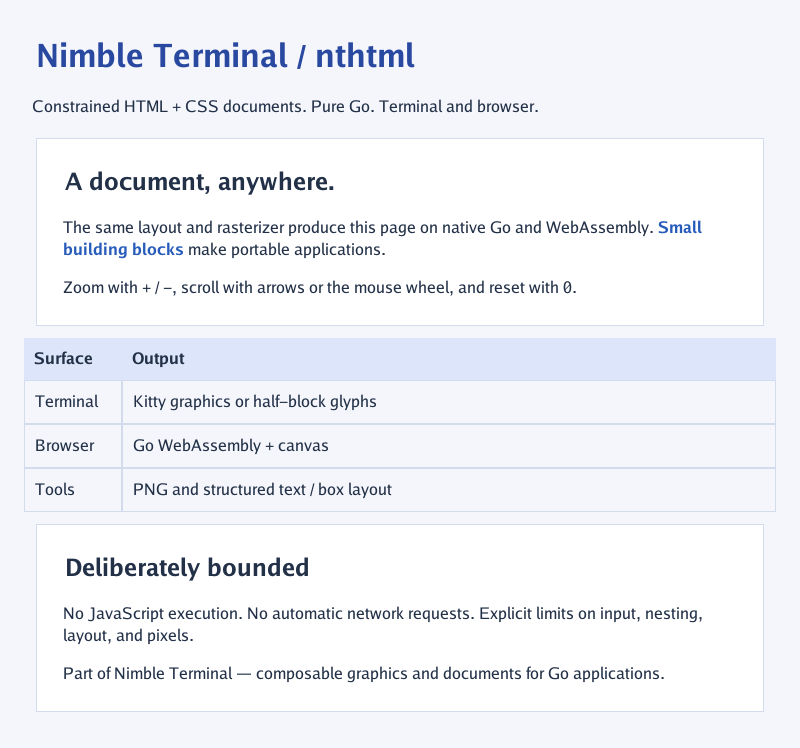
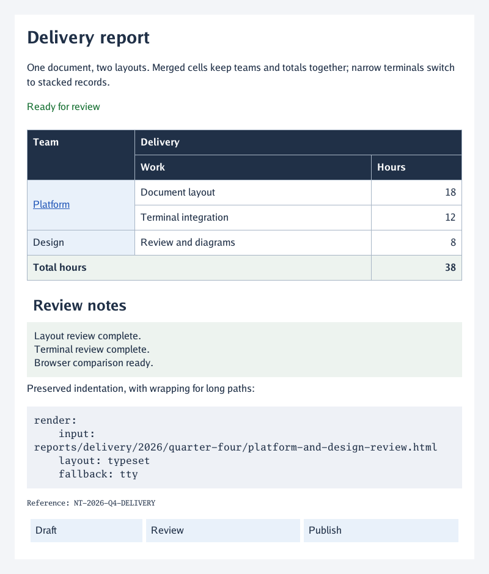

# nthtml

**Constrained HTML/CSS documents, not a browser.**

A pure-Go document renderer for [Nimble Terminal](https://nimbleterminal.dev).
Render HTML into pixels and structured boxes, display it with Bubble Tea v2
through [ntpicture](https://github.com/NimbleTerminal/ntpicture), or compile the
same renderer to WebAssembly. No CGO, browser engine, JavaScript execution, or
implicit network/file access.



## Quickstart

```sh
go get nimbleterminal.dev/nthtml
go run ./examples/demo
go run ./cmd/nthtml -width 800 -o document.png examples/demo/sample.html
```

```go
result, err := document.Render(ctx, strings.NewReader(`
  <style>h1 { color: #2948a0; }</style>
  <h1>Hello, Nimble Terminal</h1><p>A portable document.</p>
`), document.Options{Width: 800})
if err != nil {
    return err
}
// result.Image is an *image.RGBA; result.Boxes contains text and pixel bounds.
viewer := nthtml.New(result)
_ = viewer
```

Import `nimbleterminal.dev/nthtml` and `nimbleterminal.dev/nthtml/document`.
Use `document.Parse` followed by `Document.Render` to reuse parsed documents.
The document package has no Bubble Tea dependency. Its image can be sent directly
to `ntpicture.Picture.SetImage`, encoded as PNG, or composed with other images.
Text boxes expose font size, weight, color, and bounds for host adapters such as
nttypeset; there is no direct nttypeset adapter yet.

## Task runner

A `Taskfile.yml` follows the neighboring Nimble Terminal projects. With Go Task
installed, `task --list` shows the available commands. Tasks disable CGO and
parent Go workspaces by default.

```sh
task                         # build CLI and terminal demo into bin/
task demo                    # platform overview; press t for TTY layout
task invoice                 # also: field-notes, status-report
task demo DEMO=field-notes
task serve                   # build and serve the browser gallery on localhost:8080
task serve PORT=8090
task render INPUT=examples/demo/documents/invoice.html OUTPUT=invoice.png
task previews                # regenerate the checked-in demo PNGs
task check                   # native tests, vet, formatting, module checks
task test -- -count=1
task ci                      # native + WASM builds/tests and browser smoke checks
```

Browser smoke tests and WASM tests require Node; `task serve` requires Python 3.
Use `task fmt` and `task go-tidy` to update formatting and module files.

## Demo gallery

Five embedded documents run through the same renderer on native Go and WASM:

| Demo | What it shows | Terminal command |
| --- | --- | --- |
| Platform overview | Cards, inline emphasis, feature table | `go run ./examples/demo` |
| Studio invoice | Nested blocks, itemized table, right-aligned totals | `go run ./examples/demo -demo invoice` |
| Field notes | Editorial typography, pull quote, long-page scrolling | `go run ./examples/demo -demo field-notes` |
| Delivery status | Dark palette, metric cards, service report | `go run ./examples/demo -demo status-report` |
| Documentation guide | Interactive links, nested lists, inline code and preformatted blocks | `go run ./examples/demo -demo guide` |

The browser gallery has a document picker and shareable URLs such as
`http://localhost:8080/?demo=invoice`. **Show browser reference** opens a
side-by-side iframe containing the exact embedded HTML sent to the Go renderer.
With the reference closed, the Go view lives in a resizable container: drag its
lower-right corner, set **Container width**, or use **Fit pane**. Resize events
rerun Go layout at the available pixel width and rewrap TTY tables/text using the
measured monospace cell width. The heading shows the current pixels or columns;
zoom still magnifies the resulting layout. Resize updates are debounced.

With the reference open, both views use a fixed 800-pixel document width; the
browser uses its native fonts, styles, and layout rules. The panes scroll independently, and the comparison
stacks vertically on small screens. Close it with the same button or **Close**.
`?demo=invoice&compare=1` opens the reference immediately and keeps it open when
switching demos. The iframe is sandboxed without script or same-origin privileges.
All business names and operational data are fictional. HTML sources live in [examples/demo/documents](examples/demo/documents).

Render a standalone preview without starting a terminal UI:

```sh
go run ./cmd/nthtml -o invoice.png examples/demo/documents/invoice.html
```

Preview images: [invoice](examples/demo/previews/invoice.png),
[field notes](examples/demo/previews/field-notes.png),
[status report](examples/demo/previews/status-report.png),
[documentation guide](examples/demo/previews/guide.png).

## Terminal component

The component follows ntpicture's pointer-mutating convention:

- Return `viewer.Init()` from the parent's `Init`.
- Forward all messages through `viewer.Update(msg)` and run returned commands.
- Call `SetSize(columns, rows)` on resize and compose `viewer.View()` into the parent's view. For a nonzero origin, use `SetBounds(x, y, columns, rows)` so mouse coordinates match the composed widget.
- Forward input only while focused; the parent owns focus and quit handling.
- Enable `tea.MouseModeCellMotion` for mouse-wheel scrolling.
- On exit run `tea.Sequence(viewer.Close(), tea.Quit)`; also defer `viewer.Close()` for resource cleanup.

Press **t** to toggle **Typeset** (the styled raster page) and **TTY** (readable
plain text reflowed to terminal cells). The browser gallery has the same toggle
as a button and keyboard shortcut. Its selectable TTY text reflows with the
resizable container; comparison mode uses 80 columns with horizontal scrolling
on narrower screens to preserve table alignment. Each mode retains its own scroll position. Switching back
to Typeset restores the raster zoom and pan. TTY omits CSS decorations, respects
hidden content, represents images by alt text, and draws Unicode-bordered tables with header
separators, wrapped cells, and left/center/right alignment from CSS. Columns fit
the available terminal width; very narrow layouts switch to stacked records.
Nested tables flatten inside their parent cell; colspan/rowspan remain unsupported.
TTY output is capped at 4 MiB. It strips terminal control characters from document text.

Hosts can call `viewer.SetLayoutMode(nthtml.LayoutTTY)`,
`viewer.ToggleLayout()`, or inspect `viewer.LayoutMode()`. Run returned commands
so Kitty placements are hidden/restored correctly. `viewer.Err()` reports TTY
conversion errors. Lower-level consumers can call `doc.TTY(ctx, columns)` or
`result.TTY(ctx, columns)` without using the widget. Rendered results retain their
immutable parsed document for reflow; manually constructed results have no TTY
content. “Typeset” names the existing nthtml raster layout, not integration with
the separate nttypeset engine.

Arrows / hjkl pan, Page Up / Down scroll, + / − zoom the Typeset view, and
0 / Home reset the active view.
Kitty support is detected by ntpicture, with half-block glyph fallback.
Zoom crops the raster; it does not reflow or regenerate higher-resolution text.
The example uses a full-screen component; multiple positioned Kitty widgets are
not exposed by this first wrapper.

## Links, lists, and code

Use `<a href="https://example.com">label</a>` for hyperlinks. Typeset links are
colored and underlined. `Result.Links` exposes safe destinations, stable IDs, and
pixel rectangles; `Result.LinkAt(image.Point)` performs hit testing. Wrapped links
can have several rectangles. `Document.Links(ctx)` returns visible link metadata
without rasterizing.

In the component, **Tab / Shift-Tab** select the next/previous link and scroll it
into view. **Left-click** activates links in Typeset and TTY modes; **Enter**
activates the keyboard selection. External/relative destinations emit `nthtml.LinkMsg{Owner, Link}`; local `#fragment` links scroll inside the widget. The component never opens
URLs itself. Handle that message in the parent to choose an opener or custom
navigation. The terminal demo opens absolute HTTP(S)/mailto destinations using
`open` on macOS or `xdg-open` on Linux; other targets report the URL. Mouse hit testing accounts for the widget origin, TTY scroll offset, raster
zoom/pan, and Kitty/glyph letterboxing. Use `Model.LinkAtCell(image.Point)` for
screen-cell hit testing. A press/release must stay on the same link and cell;
dragging cancels activation. Clicks are ignored while a replacement raster is
pending so they cannot activate a target from an undisplayed layout.

`Document.TTYLayout(ctx, columns)` (also available on `Result`) returns plain
`Text`, cell-based `Links`, and UTF-8 byte-offset `Spans`. Use `.ANSI()` to opt into
OSC 8 hyperlinks; the widget does this automatically. Every line closes its
hyperlinks, so scrolling cannot leak them into neighboring rows. Unsupported
terminals still show readable text. `TTY()` remains escape-free. ANSI generation
falls back to plain text if escape expansion would exceed its 4 MiB budget.

The browser demo uses real, keyboard-focusable anchors over the canvas hit
regions and around TTY spans. External links open a new tab; local fragment links
scroll within the document. The
links are rebuilt when the document reflows; source HTML is never inserted into
the main page.

Only HTTP(S), mailto, and relative references are exposed as links. Controls,
backslashes, embedded whitespace, URLs longer than 2,048 bytes, and schemes such
as `javascript:`, `data:`, and `file:` are rejected; their visible text still
renders. Relative references are retained for the host: use
`document.ResolveURL(base, href)` before external activation. The browser demo
resolves them against its own page URL. Local fragments target visible IDs and named anchors; no resources are fetched
while laying out links.

`ul` / `ol` / `li` produce bullets or decimal numbering with hanging indentation,
including nested lists. Ordered lists honor `start` and item `value`. Reversed
lists, alternate numbering styles, and CSS list markers remain unsupported.

`code` selects bundled Go monospace regular/bold faces. `pre` preserves spaces,
indentation and blank lines, expands tabs to four-column stops, and soft-wraps
long lines to fit the document. Typeset code blocks have a shaded background;
TTY is already monospace and retains the whitespace without decoration. A single
initial newline in `pre` is stripped. There is no syntax highlighting or
full CSS line-breaking implementation. Supported whitespace modes are listed below.

## Support matrix

This describes the current implementation, not a roadmap. **Partial** means the
specific subset below works; it does not imply browser-compatible behavior.
**Not supported** means callers should not depend on that feature.

### HTML and CSS

| Feature | Status | What works / current boundary |
| --- | --- | --- |
| HTML parsing | Partial | Documents and fragments, entities, explicit start/end tags, and tolerant handling of unmatched tags. Bounded token-stack parser; no browser tree repair or implied paragraph/table closures. |
| Block and inline flow | Partial | Blocks, paragraphs, inline text spans, and `br`. `display: block`, `inline`, and `none`. No inline-block formatting, floats, flexbox, grid, or positioned layout. |
| Headings and emphasis | Partial | Built-in styles for `h1`, `h2`, and bold `b` / `strong` / `th`. Other headings behave as ordinary blocks unless styled. `code` uses monospace. `em` / `i` are italic; `small` is inline without automatic smaller type. |
| Whitespace and line breaks | Partial | `white-space: normal`, `nowrap`, `pre`, `pre-wrap`, `pre-line`, and constrained `break-spaces`; `overflow-wrap: normal`, `break-word`, `anywhere` (`word-wrap` alias). Tabs expand to four cells. Defaults retain emergency long-word wrapping and soft-wrapped `pre` for documents; explicit `nowrap` / `pre` disable wrapping. No full Unicode line-breaking, hyphenation, or ellipsis. |
| Lists | Partial | Bullets, decimal numbering, nested/hanging indentation, `ol start`, and `li value`. No reversed lists, alternative marker styles, `list-style` properties, or CSS counters. |
| Stylesheet sources | Partial | Embedded `<style>` and inline `style` attributes. No external stylesheets, imports, or media-query evaluation. |
| Selectors and cascade | Partial | Tag, `.class`, `#id`, `*`, compounds such as `table.invoice.active`, descendant and child (`>`) combinators, and comma-separated lists. Specificity, source order, inline styles, and author `!important` precedence, including supported shorthand expansion. ASCII identifiers; selectors capped at 1,024 bytes / 64 terms. No sibling combinators, escapes, attribute selectors, pseudo-classes/elements, cascade layers, or full shorthand grammar. |
| Box spacing and sizing | Partial | One-to-four-value `margin` / `padding`, per-side overrides, `width`, `max-width`, and `height` (definite block height with visible overflow; table heights remain minimums); `box-sizing`. Nonnegative pixels and percentages; unitless lengths mean pixels. Horizontal auto margins center or align constrained boxes. Percentage heights require a definite parent height. Available width constrains boxes; spacing is capped at 256px per side. No negative margins, margin collapse, `min-width`, `min-height`, `max-height`, `em` / `rem`, viewport units, or `calc()`. |
| Borders and backgrounds | Partial | Uniform solid borders using `border`, `border-width`, and `border-color`; solid `background` / `background-color`. No individual sides, dashed/dotted styles, radius, shadows, gradients, or background images. |
| Typography | Partial | Go defaults plus seven embedded ntfonts families; `font-family` fallback lists and generic serif/sans-serif/monospace; regular, bold, italic, and bold italic faces. `font-size` in pixels or percent; numeric `font-weight` maps to regular/bold; `font-style`; pixel, percentage, or unitless-multiplier `line-height`; underline/line-through via `text-decoration` or `text-decoration-line`; left/center/right `text-align`. No justification, letter/word spacing, or external font downloads. |
| Unicode text | Partial | Text is drawn from the bundled fonts; TTY wrapping measures terminal cells. No full complex-script shaping, bidi layout, font fallback, or guaranteed emoji coverage. |
| Colors | Partial | `#rgb`, `#rrggbb`, `black`, `white`, `red`, `green`, `blue`, `gray`, and `transparent`. No alpha hex, `rgb()` / `hsl()`, `currentColor`, or full named-color set. |
| Tables | Partial | Shared content-aware Typeset column widths across explicit rows and row groups (`thead`, `tbody`, `tfoot`); top captions, nested tables, bold headers, row/group backgrounds, uniform row heights, and cell `text-align` / `vertical-align: top\|middle\|bottom`. TTY uses content-based column widths and wrapping. Solid `border-collapse: collapse` / `separate`, with shared-edge conflict resolution. `colspan` / `rowspan` share a bounded grid in both layouts; `rowspan="0"` reaches the end of its row group. Typeset supports one/two pixel lengths for `border-spacing` (0 by default, capped at 256px; ignored when collapsed). TTY keeps compact Unicode borders without pixel gutters. No `colgroup` or full CSS intrinsic sizing. |
| Images | Partial | Explicit `Options.Images[src]` allowlist; `Document.ImageSources` lists the `src` values to decide on; PNG/JPEG/GIF decode helpers and base64 data URL helper. Images take their own pixel size, the `width`/`height` attributes, or a CSS width, keep their aspect ratio when one side is given, and never exceed the containing box. Missing images show alt text. No automatic file/URL loading, animated playback, or browser-style inline image layout (each image is its own block). |
| Embedded SVG | Partial | Inline `<svg>` fragments rasterize through ntsvg; shapes, paths, text, basic gradients, and markers in a bounded SVG subset. Aspect ratio is preserved; width/height attributes and CSS sizing are supported. TTY uses aria-label/title/desc. No external resources, use/references inside definitions, SVG stylesheets, scripts, foreignObject, or SVG-internal link navigation. |
| Mermaid | Partial | `pre.mermaid`, `div.mermaid`, or `pre > code.language-mermaid`; flowchart/graph, sequenceDiagram, stateDiagram-v2, classDiagram, and pie via pure-Go go-mermaid → ntsvg. TTY retains source. Not full Mermaid compatibility; directives and other diagram families are unsupported. |
| Other embedded media | Not supported | No video/audio playback, embedded browser frames, or canvas execution in the document engine. |
| Hyperlinks | Partial | Safe destinations, raster hit regions, TTY spans/OSC 8, Tab/Enter widget navigation, and browser anchors. Hosts own external activation; local fragments navigate within the document. Terminal mouse clicks account for crop, zoom, and cell geometry. |
| Forms | Not supported | No editable controls, form state, or submission. |
| JavaScript and dynamic CSS | Not supported | No script execution, DOM/event system, animations, transitions, transforms, filters, or CSS variables. |

Unknown elements generally flow as blocks. Unsupported properties and selectors
have no supported effect; invalid values are not guaranteed to fall back as they
would in a browser. Inline spans carry text styles, not independent painted boxes.
The supported CSS properties are exactly those named in the table above, plus
`color`. This is an experimental document renderer, not a standards-conformant
HTML engine.

### Output modes and integrations

| Capability | Typeset | TTY |
| --- | --- | --- |
| Output | RGBA image, structured paint boxes, and link hit regions | Plain text, terminal-cell link spans, and optional OSC 8 hyperlinks |
| Visual styling | Supported font sizes, weight, colors, backgrounds, borders, and spacing | Omits font/color/box styling; respects `display: none` and table-cell alignment |
| Tables | Shared content-aware columns, merged cells, border spacing, full-height backgrounds/borders, horizontal and vertical cell alignment | Merged cells, Unicode borders, header separators, wrapped/aligned cells; stacked records when too narrow; nested tables flatten inside cells |
| Images | Rasterizes allowlisted images | Alt-text placeholder |
| Resize / reflow | Call `Document.Render` at a new pixel width; browser demo does this on container resize | Call `Document.TTY` / `Result.TTY` with new columns; widget and browser demo reflow on resize |
| Zoom / scroll | Widget zooms/crops the existing raster; browser zoom scales it; both scroll | Scrolls wrapped lines; no image zoom |
| Native terminal | `ntpicture` Kitty graphics with half-block fallback | Ordinary terminal text; no graphics protocol required |
| Browser demo | Go WASM raster displayed on canvas | Go-generated text in a selectable `<pre>` |

The native widget does **not** automatically rerender its Typeset document when
resized: it changes the viewport of the supplied image. The browser demo's
resizable container explicitly reruns layout. “Typeset” is the name of nthtml's
raster view; it does **not** currently use the separate nttypeset engine.

| Integration / target | Status |
| --- | --- |
| Pure-Go / no CGO common path | Supported |
| Native Go and `js/wasm` document API | Supported and tested; small font antialiasing differences are covered by the golden tolerance |
| Bubble Tea v2 component | Supported: mode toggle, zoom, pan, keyboard/mouse-wheel scrolling, and cleanup. Parent owns focus and quitting. |
| Multiple positioned Kitty widgets | Not exposed by the current nthtml wrapper |
| PNG export | Supported by `cmd/nthtml`; other image consumers can use `Result.Image` |
| ntfonts integration | Embedded fonts by default; custom `document.Options.Fonts` sources supported |
| ntsvg integration | Embedded SVG and Mermaid rasterization on native and WASM |
| Direct nttypeset integration | Not implemented; image and text-box outputs are available to host adapters |
| TinyGo / embedded devices | Unverified architectural goal; not a supported target yet |
| Full browser rendering | Only the demo's optional reference iframe, rendered by the host browser; not an nthtml capability |

To allow an image, decode it with `document.DecodeImage(reader)` or
`document.DecodeDataURL(src)` and insert it into `Options.Images[src]`. HTML never
opens a path or fetches a URL. `Document.ImageSources()` lists the distinct `src`
values in document order, so a host can resolve and decode exactly those under
its own policy and budget before `Render`.

To show a long result as pages (exports, printing), cut it with
`Result.PageBreak(top, limit)`: the lowest y up to `limit` that cuts no line of
text, list marker or image, or `limit` itself when keeping them whole would
leave the page less than half full. The caller owns the lifetime and total memory of
its image map and must keep images immutable during rendering.

## Resource limits

Defaults: 1 MiB input, 10,000 nodes, depth 64, 256 CSS rules, 16 million output
pixels, height 16,384, width 32–4,096, and 100,000 paint operations. `Limits` may
lower these ceilings. Exceeding a budget returns `document.ErrLimit`. Font size,
spacing and borders are also capped; each declaration list uses its first 128
entries. TTY output is capped at 4 MiB and widths at 2–1,000 terminal cells.
Rendering checks context cancellation;
caller-provided readers and image implementations must themselves return promptly.
Decoded image helpers cap encoded input at 1 MiB and decoded output at 4 million
pixels. No goroutines, network fetches or unbounded browser tree repair are used
by the document engine.

## Browser demo

```sh
./scripts/build-web.sh
python3 -m http.server 8080 --directory web
# Open http://localhost:8080
```

The native and browser builds use the same `examples/demo/main.go`, embedded HTML,
public document API, layout and raster code. Only presentation differs: Bubble Tea
on native, canvas with scroll/zoom controls in the browser. `web/` is a static site;
the build copies the matching Go WASM runtime. Generated binaries are not committed.

```sh
CGO_ENABLED=0 go test ./...
go vet ./...
GOOS=js GOARCH=wasm go build ./...
go test ./document -fuzz FuzzRender -fuzztime 10s
```

A checked-in PNG golden verifies the shared renderer. Font antialiasing can differ
by one channel level across architectures; the golden allows a two-level
tolerance on at most 1% of pixels, while layout uses the same pixel coordinates.
TinyGo/embedded targets are an architectural goal, not verified support: font rasterization and the standard
HTML tokenizer may be too large for small devices. Use the isolated `document`
package and smaller budgets when evaluating such targets.

## License

MIT. Part of the Nimble Terminal family alongside ntpicture, ntsvg, ntpdf,
nttypeset and ntvideo.

### Bubble Tea on WASM

Like ntvideo, this repository pins the WASM-capable Bubble Tea fork. Go does not
inherit dependency replacements: applications importing the root widget package
on WASM must add this to their own `go.mod`:

```go
replace charm.land/bubbletea/v2 => github.com/neomantra/bubbletea/v2 v2.0.0-20261009201241-c397c32a5074
```

Consumers importing only `document` do not need this replacement.

### Typography and responsive spacing demo

Run `task demo DEMO=typography`, or select **Typography & spacing** in the
browser gallery. Close the reference pane and resize the container to exercise
percentage widths, centered max-width boxes, and asymmetric padding.

Explicit font families come from ntfonts: Literata, Newsreader, IBM Plex Sans,
Source Serif 4, Iosevka, IBM Plex Mono, and JetBrains Mono. Generic `serif`,
`sans-serif`, and `monospace` select Literata, IBM Plex Sans, and IBM Plex Mono.
Unknown families fall through the comma-separated list and finally to Go.
This is family fallback, not per-glyph fallback. TTY mode uses the terminal's
font and omits these visual styles.

Hosts can supply `document.Options{Fonts: source}`, where source implements
`Face(family, variant string) ([]byte, error)`. Variants are Regular, Bold,
Italic, and BoldItalic. Sources must bound their own work. Each render allows
64 family/variant lookups, 128 sized faces, 4 MiB per font, and 16 MiB total font
bytes; exceeding these ceilings returns `document.ErrLimit`.

The embedded ntfonts faces use the SIL Open Font License; see
[font notices](licenses/fonts/THIRD_PARTY_NOTICES.md) and the accompanying license
texts. The library itself remains MIT licensed.

### Typeset tables

Columns share boundaries across header, body, and footer rows. A bounded text
measurement tracks unbroken words and longest explicit lines across inline markup,
paragraphs, and line breaks. Nested tables and supplied image dimensions contribute
their intrinsic widths. Space first grows columns toward their preferred widths,
then distributes surplus in proportion to those widths; longer content receives more space,
and narrow tables wrap at word or rune boundaries. Cell widths in pixels or
percentages are sizing hints, not guaranteed widths. Empty/missing cells do
not shift the remaining column boundaries; hidden cells are omitted.

Cells default to top alignment. Use `vertical-align: middle` or `bottom`
alongside `text-align: right` for numeric columns. Header cells are bold;
normal color, background, padding, and border declarations style them.
Backgrounds and borders stretch to the tallest cell in each row.

Try `task demo DEMO=invoice` for wrapped descriptions beside vertically
centered amounts. Table layout ignores cell margins and row/group box spacing,
places captions above rows, and preserves row-group source order. It does not
implement merged cells or browser table layout. Measurement is capped at
100,000 node/character/edge visits per render; tables allow at most 256 columns and
require at least one available pixel per column. Violations return
`document.ErrLimit`. Excessive horizontal cell padding shrinks at narrow widths.


Use `table { border-collapse: collapse; }` for single shared grid lines.
The default `separate` mode retains each cell's individual border. In collapse
mode, adjacent solid borders resolve to the wider border; equal widths prefer
cells over rows over the table, then the earlier top/left cell. Cell padding
reserves space for the winning shared edge, and outer edges stay inside the
table's content bounds. Captions sit above that grid. Nested tables inherit the
mode and can override it with `border-collapse: separate`.

This is constrained solid-border collapse: row-group/column borders, per-side
borders, hidden/dashed border styles, merged cells, and browser-exact intrinsic
sizing are not implemented. The grid is capped at 100,000 edge segments;
oversized grids return `document.ErrLimit`. TTY mode keeps its Unicode grid.

### Embedded SVG and Mermaid

Run `task demo DEMO=diagrams` or select **SVG & Mermaid** in the browser gallery.
The same Go code generates diagram pixels on native and WASM builds.

```html
<svg viewBox="0 0 200 80" aria-label="Blue status panel">
  <title>Status panel</title>
  <rect width="200" height="80" rx="8" fill="#2247a0"/>
  <text x="20" y="48" fill="white" font-size="20">Ready</text>
</svg>

<pre class="mermaid">
flowchart LR
    A[Document] --> B[SVG]
    B --> C[Terminal]
</pre>
```

Markdown adapters can emit `<pre><code class="language-mermaid">…</code></pre>`.
As with other HTML code blocks, escape literal `<` and `&` in diagram source.
SVG is kept separate from the HTML tree: its internal CSS cannot affect the
surrounding document. Diagrams occupy blocks even inside inline content.
An HTML anchor wrapping an SVG remains clickable; SVG-internal anchors are
unsupported. The browser reference uses its native SVG renderer and displays
Mermaid source without JavaScript.

The default adapter is `document.DefaultDiagramRenderer`. Hosts can replace
it through `Options.Diagrams` (the `DiagramRenderer` interface), or set
`Options.DisableDiagrams` to retain labels/source without rasterization.
Custom adapters must enforce their own work limits and obey the supplied
context and image bounds.

Malformed or unsupported diagram content falls back to a label/source and
adds an entry to `Result.Warnings`; the CLI and demos surface those warnings.
Unclosed SVG markup is a parse error. Resource-budget violations return
`document.ErrLimit` instead of silently dropping content.

Limits per render: 32 diagrams, up to 1 Mi pixels each and 4 Mi pixels in total
(or the smaller document pixel budget), maximum raster edge 4096 wide / 2048
high. Each SVG is limited to 256 KiB, 2,048 elements, depth 32, 16,384 numeric
coordinates, and coordinate magnitudes of 32,768. Nonzero stroke widths and dash lengths
below 0.1 are unsupported; inline SVG styles allow up to 128 declarations. Mermaid source is limited
to 4 KiB, 65 lines, 512 whitespace-separated tokens, and 256 lexical words/identifiers. Generated SVG passes
the same checks. Context cancellation is checked between stages; the upstream
Mermaid layout and SVG raster calls are synchronous and cannot be interrupted
mid-call. No subprocesses, browser runtime, CGO, font downloads, or external
resource fetching are used.

See [diagram dependency notices](licenses/diagrams/README.md).

### Document navigation, search, and copy

Try `task demo DEMO=navigation`, or select **Document navigation** in the browser
gallery. Fragment links such as `<a href="#section">Section</a>` scroll to visible
`id="section"` elements (or legacy `a name="section"` anchors). Percent-encoded
fragments are decoded; `#` goes to the top. The first visible duplicate target
wins. Missing targets do not open a browser.

| Action | Terminal viewer | Browser demo |
|---|---|---|
| Find | `/`, type query, Enter | Find field or `/` |
| Next / previous match | `n` / `N` | Next / Previous or `n` / `N` |
| Select text | Left-button drag | Drag over Typeset or TTY text |
| Select current match | `v` | TTY search selects the current match |
| Select all document text | Ctrl+A | Select all text button |
| Copy | `y` | Copy selection or browser Copy |
| Clear search / selection | Esc | Esc outside inputs |
| Follow local link | Click, or Tab then Enter | Click or keyboard activation |

Terminal Typeset selection snaps to painted text runs; TTY selection uses
terminal cells and UTF-8 rune boundaries. Selection is limited to the visible
viewport while dragging; there is no drag autoscroll. Resizing or switching
layouts clears stale selections and recomputes search positions. Search is
literal, Unicode simple-case-insensitive, and treats repeated whitespace as a
single space. It supports phrases across normal word wraps, but does not provide
regex, Unicode normalization, or browser text-fragment directives. Queries are
limited to 256 runes and results to 1,000 matches.

Typeset text comes from painted text runs, with logical spaces retained across
soft wraps; table cells follow layout order and list markers are omitted.
It does not perform OCR on SVG, Mermaid, or images. TTY copies its visible
plain-text representation, including table borders, diagram labels/source,
and line wrapping.

The widget emits `CopyMsg{Owner, Text}`; the host owns clipboard policy. The
terminal demo uses Bubble Tea's OSC 52 clipboard command, which requires
terminal support and permission. A copy request is limited to 1 MiB. Browser
copy uses the Clipboard API when available, with the browser's Copy command
as fallback. No clipboard reads occur.

Lower-level consumers can use `Result.Anchors`, `TTYResult.Anchors`, and
`Fragment(href)` for target coordinates. `TextIndex()` exposes layout-specific
UTF-8 text offsets and rectangles, with `Search`, `Regions`, `Hit`, and
`Selected` helpers. Offsets must not be reused after reflow. Widget hosts can
call `NavigateFragment`, `Search`, `NextMatch`, `SearchStatus`, `SelectRange`,
`SelectedText`, and `CopySelection`. Hosts that reserve quit keys must let
the widget consume keys while `SearchInputActive()` is true.

### Conformance testing

`task conformance` runs a pinned, offline subset of upstream [Web Platform Tests](https://web-platform-tests.org/) and writes `artifacts/conformance/index.html` plus JSON and failure image comparisons. The audited baseline is **14 PASS, 0 FAIL, 7 UNSUPPORTED**, including zero-height background painting. Unsupported prerequisites are explicitly recorded rather than counted as passes.

Native and WASM tests enforce the reviewed baseline. Use `task conformance -- -strict` to fail on any rendering failure. This is subset testing, not full browser conformance; see the [harness scope and contribution guide](internal/conformance/README.md).

### Reports and merged-table demo

Run `task demo DEMO=reports`, or select **Reports & merged tables** in the browser gallery (`task serve`). The same document demonstrates compound/descendant/child selectors, `!important`, whitespace modes, merged table headers and totals, row spans, and separated cell spacing. Resize it and toggle Typeset/TTY to compare the layouts.



Selector matching is cached during parsing and capped at 8 million work units and 100,000 resolved declarations. Tables are limited to 256 logical columns and 100,000 grid slots, in addition to the existing cumulative work and output budgets. Row spans stop at row-group boundaries; malformed overlaps shift a cell to the next free range. On narrow terminals, stacked records emit each source cell once. Cell content is wrapped to the allocated TTY cell width even if it requests nowrap; standalone nowrap text can exceed the terminal width.
