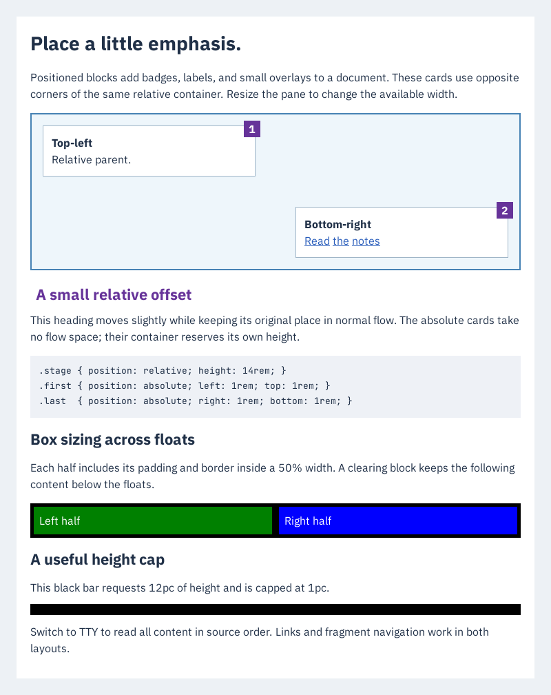

# nthtml — Constrained HTML/CSS document renderer & viewer for Bubble Tea

<p>
    <a href="https://github.com/NimbleTerminal/nthtml/tags"></a>
    <a href="https://pkg.go.dev/nimbleterminal.dev/nthtml?tab=doc"></a>
    <a href="https://github.com/NimbleTerminal/nthtml/actions/workflows/check.yml"></a>
    <a href="https://github.com/NimbleTerminal/nthtml/blob/main/CODE_OF_CONDUCT.md"></a>
</p>

**[Try the live browser demo](https://nimbleterminal.github.io/nthtml/)**

**Constrained HTML/CSS documents, not a browser.**

A pure-Go document renderer and [Bubble Tea v2](https://github.com/charmbracelet/bubbletea) viewer widget (`nimbleterminal.dev/nthtml`) for [Nimble Terminal](https://nimbleterminal.dev).
Render HTML into pixels and structured boxes, display it in the terminal through
[`ntpicture`](https://github.com/NimbleTerminal/ntpicture) (Kitty graphics or half-block glyphs) or reflowed plain-text TTY cells, or compile the
same renderer to WebAssembly. No CGO, browser engine, JavaScript execution, or
implicit network/file access.


## Quickstart

```sh
go get nimbleterminal.dev/nthtml
go run ./examples/demo
go run ./cmd/nthtml -width 800 -o document.png examples/demo/sample.html
go run ./cmd/nthtml -mode typeset -width 800 -o bridged.png typeset/testdata/structured_sections.html
go run ./cmd/nthtml -mode view typeset/testdata/structured_sections.html
```

```go
result, err := document.Render(ctx, strings.NewReader(`
  <style>h1 { color: #2948a0; }</style>
  <h1>Hello, Nimble Terminal</h1><p>A portable document.</p>
`), document.Options{Width: 800})
if err != nil {
    return err
}
// result.Image is an *image.RGBA; result.Boxes contains text and pixel bounds.
viewer := nthtml.New(result)
_ = viewer
```

Import `nimbleterminal.dev/nthtml`, `nimbleterminal.dev/nthtml/document`, and
optionally `nimbleterminal.dev/nthtml/typeset`. Use `document.Parse` followed by
`Document.Render`, `Document.TTYLayout`, or `typeset.BuildWithSources` to reuse a
parsed document across native raster, terminal-cell TTY, and `nttypeset`-backed
rendering. The `document` package has no Bubble Tea dependency. Its image can be
sent directly to `ntpicture.Picture.SetImage`, encoded as PNG, or composed with
other images, and `nimbleterminal.dev/nthtml/typeset` bridges parsed documents
(or rendered boxes) directly into `nttypeset.Document` with nested section
decorations and source anchor mappings.

## Task runner

A `Taskfile.yml` follows the neighboring Nimble Terminal projects. With Go Task
installed, `task --list` shows the available commands. Tasks disable CGO and
parent Go workspaces by default.

```sh
task                         # build CLI and terminal demo into bin/
task demo                    # platform overview; press t for TTY layout
task invoice                 # also: field-notes, status-report
task demo DEMO=field-notes
task serve                   # build and serve the browser gallery on localhost:8080
task serve PORT=8090
task render INPUT=examples/demo/documents/invoice.html OUTPUT=invoice.png
task previews                # regenerate the checked-in demo PNGs
task check                   # native tests, vet, formatting, module checks
task test -- -count=1
task conformance             # pinned offline WPT reference subset
task differential            # optional Chromium differential geometry/screenshot report
task ci                      # native + WASM builds/tests and browser smoke checks
```

Browser smoke tests and WASM tests require Node; `task serve` requires Python 3.
Use `task fmt` and `task go-tidy` to update formatting and module files.

## Demo gallery

Ten embedded documents run through the same renderer on native Go and in the [live WebAssembly browser gallery](https://nimbleterminal.github.io/nthtml/):

| Demo | What it shows | Live web demo | Side-by-side compare | Terminal command |
| --- | --- | --- | --- | --- |
| Platform overview | Cards, inline emphasis, feature table | [overview](https://nimbleterminal.github.io/nthtml/?demo=overview) | [compare](https://nimbleterminal.github.io/nthtml/?demo=overview&compare=1) | `task demo` (`go run ./examples/demo`) |
| Studio invoice | Nested blocks, itemized table, right-aligned totals | [invoice](https://nimbleterminal.github.io/nthtml/?demo=invoice) | [compare](https://nimbleterminal.github.io/nthtml/?demo=invoice&compare=1) | `task invoice` (`go run ./examples/demo -demo invoice`) |
| Field notes | Editorial typography, pull quote, long-page scrolling | [field-notes](https://nimbleterminal.github.io/nthtml/?demo=field-notes) | [compare](https://nimbleterminal.github.io/nthtml/?demo=field-notes&compare=1) | `task field-notes` (`go run ./examples/demo -demo field-notes`) |
| Delivery status | Dark palette, metric cards, service report | [status-report](https://nimbleterminal.github.io/nthtml/?demo=status-report) | [compare](https://nimbleterminal.github.io/nthtml/?demo=status-report&compare=1) | `task status-report` (`go run ./examples/demo -demo status-report`) |
| Documentation guide | Interactive links, nested lists, inline code and preformatted blocks | [guide](https://nimbleterminal.github.io/nthtml/?demo=guide) | [compare](https://nimbleterminal.github.io/nthtml/?demo=guide&compare=1) | `task demo DEMO=guide` |
| Typography & spacing | Embedded `ntfonts` families, relative/physical length rulers, responsive padding | [typography](https://nimbleterminal.github.io/nthtml/?demo=typography) | [compare](https://nimbleterminal.github.io/nthtml/?demo=typography&compare=1) | `task demo DEMO=typography` |
| SVG & Mermaid | Embedded `<svg>` and `<pre class="mermaid">` diagrams via `ntsvg` | [diagrams](https://nimbleterminal.github.io/nthtml/?demo=diagrams) | [compare](https://nimbleterminal.github.io/nthtml/?demo=diagrams&compare=1) | `task demo DEMO=diagrams` |
| Document navigation | Fragment `#id` links, text search (`/`), selection, and copy (`y`) | [navigation](https://nimbleterminal.github.io/nthtml/?demo=navigation) | [compare](https://nimbleterminal.github.io/nthtml/?demo=navigation&compare=1) | `task demo DEMO=navigation` |
| Reports & merged tables | Compound selectors, `!important`, `colspan`/`rowspan`, `border-collapse` | [reports](https://nimbleterminal.github.io/nthtml/?demo=reports) | [compare](https://nimbleterminal.github.io/nthtml/?demo=reports&compare=1) | `task demo DEMO=reports` |
| Positioned blocks | Relative/absolute positioning, `float` + `clear`, `box-sizing: border-box` | [positioning](https://nimbleterminal.github.io/nthtml/?demo=positioning) | [compare](https://nimbleterminal.github.io/nthtml/?demo=positioning&compare=1) | `task demo DEMO=positioning` |
| Styled conversation | CSS colors and emphasis in Typeset and TTY, search, width/contain fit | [tty-styles](https://nimbleterminal.github.io/nthtml/?demo=tty-styles) | [compare](https://nimbleterminal.github.io/nthtml/?demo=tty-styles&compare=1) | `go run ./examples/tty-styles` |

The browser gallery has a document picker and shareable URLs such as
`https://nimbleterminal.github.io/nthtml/?demo=invoice` (or `http://localhost:8080/?demo=invoice` locally). **Show browser reference** opens a
side-by-side iframe containing the exact embedded HTML sent to the Go renderer.
With the reference closed, the Go view lives in a resizable container: drag its
lower-right corner, set **Container width**, or use **Fit pane**. Resize events
rerun Go layout at the available pixel width and rewrap TTY tables/text using the
measured monospace cell width. The heading shows the current pixels or columns;
zoom still magnifies the resulting layout. Resize updates are debounced.

With the reference open, both views use a fixed 800-pixel document width; the
browser uses its native fonts, styles, and layout rules. The panes scroll independently, and the comparison
stacks vertically on small screens. Close it with the same button or **Close**.
`?demo=invoice&compare=1` opens the reference immediately and keeps it open when
switching demos. The iframe is sandboxed without script or same-origin privileges.
All business names and operational data are fictional. HTML sources live in [examples/demo/documents](examples/demo/documents).

Render a standalone preview without starting a terminal UI:

```sh
go run ./cmd/nthtml -o invoice.png examples/demo/documents/invoice.html
```

Checked-in preview images: [overview](document/testdata/demo.png),
[invoice](examples/demo/previews/invoice.png),
[field notes](examples/demo/previews/field-notes.png),
[status report](examples/demo/previews/status-report.png),
[documentation guide](examples/demo/previews/guide.png),
[typography](examples/demo/previews/typography.png),
[diagrams](examples/demo/previews/diagrams.png),
[navigation](examples/demo/previews/navigation.png),
[reports](examples/demo/previews/reports.png),
[positioning](examples/demo/previews/positioning.png).

## Terminal component

The component follows ntpicture's pointer-mutating convention:

- Return `viewer.Init()` from the parent's `Init`.
- Forward all messages through `viewer.Update(msg)` and run returned commands.
- Call `SetSize(columns, rows)` on resize and compose `viewer.View()` into the parent's view. For a nonzero origin, use `SetBounds(x, y, columns, rows)` so mouse coordinates match the composed widget.
- Forward input only while focused; the parent owns focus and quit handling.
- Enable `tea.MouseModeCellMotion` for mouse-wheel scrolling.
- On exit run `tea.Sequence(viewer.Close(), tea.Quit)`; also defer `viewer.Close()` for resource cleanup.

Press **t** to toggle **Typeset** (the styled raster page) and **TTY** (readable
styled text reflowed to terminal cells). The browser gallery has the same toggle
as a button and keyboard shortcut. Its selectable TTY text reflows with the
resizable container; comparison mode uses 80 columns with horizontal scrolling
on narrower screens to preserve table alignment. Each mode retains its own scroll position. Switching back
to Typeset restores the raster zoom and pan. TTY carries CSS colors and emphasis, respects
hidden content, represents images by alt text, and draws Unicode-bordered tables with header
separators, wrapped cells, and left/center/right alignment from CSS. Columns fit
the available terminal width; very narrow layouts switch to stacked records.
Nested tables flatten inside their parent cell; colspan/rowspan remain unsupported.
TTY output is capped at 4 MiB. It strips terminal control characters from document text.

Hosts can call `viewer.SetLayoutMode(nthtml.LayoutTTY)`,
`viewer.ToggleLayout()`, or inspect `viewer.LayoutMode()`. Run returned commands
so Kitty placements are hidden/restored correctly. `viewer.Err()` reports TTY
conversion errors. Lower-level consumers can call `doc.TTY(ctx, columns)` or
`result.TTY(ctx, columns)` without using the widget. Rendered results retain their
immutable parsed document for reflow; manually constructed results have no TTY
content. “Typeset” names the existing nthtml raster layout, not integration with
the separate nttypeset engine.

Arrows / hjkl pan, Page Up / Down scroll, + / − zoom the Typeset view, and
0 / Home reset the active view.
Kitty support is detected by ntpicture, with half-block glyph fallback.
Zoom crops the raster; it does not reflow or regenerate higher-resolution text.
The example uses a full-screen component; multiple positioned Kitty widgets are
not exposed by this first wrapper.

## Links, lists, and code

Use `<a href="https://example.com">label</a>` for hyperlinks. Typeset links are
colored and underlined. `Result.Links` exposes safe destinations, stable IDs,
element anchor names (`Link.Anchor`, from `id` or `name`), and
pixel rectangles; `Result.LinkAt(image.Point)` performs hit testing. Wrapped links
can have several rectangles. `Document.Links(ctx)` returns visible link metadata
without rasterizing.

In the component, **Tab / Shift-Tab** select the next/previous link and scroll it
into view. **Left-click** activates links in Typeset and TTY modes; **Enter**
activates the keyboard selection. External/relative destinations emit `nthtml.LinkMsg{Owner, Link}`; local `#fragment` links scroll inside the widget. The component never opens
URLs itself. Handle that message in the parent to choose an opener or custom
navigation. The terminal demo opens absolute HTTP(S)/mailto destinations using
`open` on macOS or `xdg-open` on Linux; other targets report the URL. Mouse hit testing accounts for the widget origin, TTY scroll offset, raster
zoom/pan, and Kitty/glyph letterboxing. Use `Model.LinkAtCell(image.Point)` for
screen-cell link hit testing and `Model.CellToDocument(image.Point)` for mapping
a screen cell to its document-pixel rectangle in Typeset mode.
`Model.DocumentViewport()` returns `(image.Rectangle, bool)` for the visible
Typeset document-pixel bounds, excluding letterboxing. Its `Min` is the actual
displayed scroll origin (including Kitty's cell-row snapping), and its `Size()`
is the visible extent. It accounts for band offsets, zoom, and raster scaling,
rounding fractional pixel edges outward once for the whole viewport. It returns
false in TTY mode or when no document pixels are visible. Both accessors report
current target geometry, which may still be pending presentation; querying them
does not change scroll or selection. Use this accessor rather than
`Picture.Crop()`, which describes the uploaded picture's transport geometry.
A press/release must stay on the same link and cell;
dragging cancels activation. Clicks are ignored while a replacement raster is
pending so they cannot activate a target from an undisplayed layout.

`Document.TTYLayout(ctx, columns)` (also available on `Result`) returns plain
`Text`, cell-based `Links`, UTF-8 byte-offset `Spans`, and CSS `Styles`. Use `.ANSI()`
to emit truecolor SGR and OSC 8 hyperlinks; the widget does this automatically.
Every line closes styling and links, so scrolling cannot leak terminal state. Unsupported
terminals still show readable text. `TTY()` remains escape-free. ANSI generation
falls back to plain text if escape expansion would exceed its 4 MiB budget.

See [TTY styling](docs/tty-styling.md) for supported CSS, color profiles, and
highlight composition. Run `go run ./examples/tty-styles` to compare styled TTY
and Typeset side by side using the same HTML/CSS.

The browser demo uses real, keyboard-focusable anchors over the canvas hit
regions and around TTY spans. External links open a new tab; local fragment links
scroll within the document. The
links are rebuilt when the document reflows; source HTML is never inserted into
the main page.

Only HTTP(S), mailto, and relative references are exposed as links. Controls,
backslashes, embedded whitespace, URLs longer than 2,048 bytes, and schemes such
as `javascript:`, `data:`, and `file:` are rejected; their visible text still
renders. Relative references are retained for the host: use
`document.ResolveURL(base, href)` before external activation. The browser demo
resolves them against its own page URL. Local fragments target visible IDs and named anchors; no resources are fetched
while laying out links.

`ul` / `ol` / `li` produce bullets or decimal numbering with hanging indentation,
including nested lists. Ordered lists honor `start` and item `value`. Reversed
lists, alternate numbering styles, and CSS list markers remain unsupported.

`code` selects bundled Go monospace regular/bold faces. `pre` preserves spaces,
indentation and blank lines, expands tabs to four-column stops, and soft-wraps
long lines to fit the document. Typeset code blocks have a shaded background;
TTY is already monospace and retains the whitespace without decoration. A single
initial newline in `pre` is stripped. There is no syntax highlighting or
full CSS line-breaking implementation. Supported whitespace modes are listed below.

## Support matrix

This describes the current implementation, not a roadmap. **Partial** means the
specific subset below works; it does not imply browser-compatible behavior.
**Not supported** means callers should not depend on that feature.

### HTML and CSS

| Feature | Status | What works / current boundary |
| --- | --- | --- |
| HTML parsing | Partial | Documents and fragments, entities, explicit start/end tags, and tolerant handling of unmatched tags. Bounded token-stack parser; no browser tree repair or implied paragraph/table closures. |
| Block and inline flow | Partial | Blocks, paragraphs, `blockquote`, `hr`, `dl`/`dt`/`dd`, inline text spans, inline images (with `vertical-align: baseline \| bottom \| middle`), `display: inline-block` (with shrink-to-fit auto width and baseline alignment), constrained 1D flexbox (`display: flex` / `inline-flex`, `flex-direction`, `flex-wrap`, `gap` / `row-gap` / `column-gap`, `justify-content`, `align-items`, `flex-grow` / `flex-shrink` / `flex-basis`), constrained 2D grid (`display: grid` / `inline-grid`, `grid-template-columns` with fixed/percentage/`calc()` tracks, `fr`, `minmax()`, `repeat()`, `grid-column` / `grid-column-start` / `grid-column-end`, `gap` / `grid-gap`), `overflow: hidden` / `clip`, `text-overflow: ellipsis`, `visibility: visible \| hidden \| collapse`, `opacity`, and `br`. `display: block`, `inline`, `inline-block`, `flex`, `inline-flex`, `grid`, `inline-grid`, and `none`. Constrained relative/absolute positioning with signed `top` / `right` / `bottom` / `left` (and `inset` shorthand) offsets and integer `z-index` stacking. Left/right block floats with percentage or shrink-to-fit width, basic inline text exclusions, and `clear: left/right/both`. No fixed/sticky positioning. |
| Headings and emphasis | Partial | Built-in styles for `h1`–`h6`, bold `b` / `strong` / `th` / `dt`, `small` (~85% font size), `sub` / `sup` (~80% font size with baseline offset), `mark` (highlight background), `u` (underline), `s` / `del` (strikethrough), `em` / `i` (italic), and `code` (monospace). |
| Whitespace and line breaks | Partial | `white-space: normal`, `nowrap`, `pre`, `pre-wrap`, `pre-line`, and constrained `break-spaces`; `overflow-wrap: normal`, `break-word`, `anywhere` (`word-wrap` alias); `text-overflow: ellipsis` on nowrap clipped lines. Zero-width spaces (`U+200B`) provide break opportunities without rendering `.notdef` glyphs. Tabs expand to four cells. Defaults retain emergency long-word wrapping and soft-wrapped `pre` for documents; explicit `nowrap` / `pre` disable wrapping. No full Unicode line-breaking or hyphenation. |
| Lists | Partial | Bullets (`disc`, `circle`, `square`), decimal/leading-zero, alphabetic (`lower-alpha`, `upper-alpha`), and Roman (`lower-roman`, `upper-roman`) numbering, `list-style-type` / `list-style` (`none` supported), nested/hanging indentation, `ol start`, `ol reversed`, `type="1\|a\|A\|i\|I"`, and `li value`. No `list-style-image` or CSS counters. |
| Stylesheet sources | Partial | Embedded `<style>` and inline `style` attributes. CSS custom properties (`--name: value`, inherited down the DOM tree) and `var(--name[, fallback])` substitution across properties. `@media` blocks (nested up to depth 8, prelude up to 1,024 bytes) are evaluated against the render width in CSS px (`columns * 10` px in TTY mode) and `Options.ColorScheme` (`"light"` or `"dark"`, default `"light"`) for `screen`/`all`, `not`, `only`, `and`, comma-separated OR lists, `width`/`min-width`/`max-width`, and `prefers-color-scheme: light \| dark`; all rules inside `@media` count toward `Limits.Rules` at parse time. Statement at-rules (`@import`, `@charset`, `@namespace`) are skipped up to `;`; other block at-rules (`@font-face`, `@keyframes`, `@supports`, `@layer`, `@page`, and unknown block at-rules) are skipped with brace matching (`@supports` bodies are skipped, not evaluated). No external stylesheet fetching. |
| Selectors and cascade | Partial | Tag, `.class`, `#id`, `*`, attribute selectors (`[attr]`, `=`, `~=`, `\|=`, `^=`, `$=`, `*=` with `i`/`s` flags), structural pseudo-classes (`:root`, `:first-child`, `:last-child`, `:only-child`, `:empty`, `:first-of-type`, `:last-of-type`, `:only-of-type`, `:nth-child`, `:nth-last-child`, `:nth-of-type`, `:nth-last-of-type`, `:link`, `:any-link`, `:lang(...)`), functional selector-list pseudo-classes (`:is(...)`, `:where(...)` with zero specificity, `:not(...)` with selector lists, `:has(...)` with relative child/descendant/sibling selectors), static form-state pseudo-classes (`:checked`, `:disabled`, `:enabled`, `:required`, `:optional`, `:read-only`, `:read-write`, `:indeterminate`, `:placeholder-shown`), dynamic/interactive pseudo-classes (`:visited`, `:hover`, `:active`, `:focus`, `:focus-visible`, `:focus-within`, `:target`, which parse in selector lists and never match), pseudo-elements (`::before`, `::after` with bounded `content` strings, `:first-line` scoped to the first formatted line; `::placeholder`, `::marker`, `::selection`, `::backdrop`, and `::-webkit-*`/`::-moz-*` parse without error and are ignored), compounds such as `table.invoice.active`, descendant, child (`>`), adjacent sibling (`+`), and general sibling (`~`) combinators, and comma-separated lists. Specificity, source order, inline styles, author `!important` precedence, HTML presentational hints below author rules, and CSS-wide keywords (`inherit`, `initial`, `unset`), including supported shorthand expansion. ASCII identifiers; selectors capped at 1,024 bytes / 64 terms. No escapes, cascade layers, or full shorthand grammar. |
| HTML presentational attributes | Partial | Mapped as author-level presentational hints (§15.3) with lower precedence than any author CSS rule (including specificity `0,0,0`): `bgcolor` on `body`, `table`, `thead`, `tbody`, `tfoot`, `tr`, `td`, `th` (including legacy 3/6-hex without `#`); `align` on `div`, `p`, `h1`–`h6`, `td`, `th`, `tr`, `thead`, `tbody`, `tfoot`, `caption` (`text-align`) and `table` (horizontal auto margins); `valign` on `td`, `th`, `tr`, `thead`, `tbody`, `tfoot` (`vertical-align`); `cellpadding` and `cellspacing` on `table`; `width`/`height` on `table`, `td`, `th`, `tr` (`px` or `%`); `border="N"` (`N > 0`) on `table` (1px solid border on table and cells); `<center>` (centers inline text and block/table children via auto margins); `<font color/size/face>`; and `<body text/link>`. |
| Box spacing and sizing | Partial | One-to-four-value `margin` / `padding`, per-side and logical (`margin-block`, `margin-inline`, `padding-block`, `padding-inline`, and `-start`/`-end`) overrides, `width`, `min-width`, `max-width`, ordinary-block `height` / `min-height` / `max-height`, and `aspect-ratio` (`<number>` or `<w> / <h>`), with visible or `hidden`/`clip` overflow; table heights remain minimums. Inline elements support horizontal `margin` / `padding` / `border`, full four-side inline borders across line wraps, and `background-color`. `box-sizing` applies to these constraints. Nonnegative `px`, `%`, `em`, `rem`, `vw`, `vh`, `vmin`, `vmax` (against `Options.Width` and `Options.ViewportHeight`), `in`, `cm`, `mm`, `q`, `pt`, and `pc` (signed up to ±256px for `margin`), plus `calc()`, `clamp()`, `min()`, and `max()` math functions combining lengths and percentages; unitless lengths still mean pixels. Horizontal auto margins center or align constrained boxes. Percentage heights require a definite parent height. Available width constrains boxes; spacing is capped at 256px per side. Min wins over max, subject to the containing-width/resource caps. Adjoining vertical margins (positive and negative) collapse between block siblings, through empty blocks, and across eligible parent/child edges (`maxPositive + minNegative`). Borders, padding, inline lines, height constraints, root boxes, flex/grid containers, and table cells keep their layout boundaries. List interiors retain marker-specific spacing. Clearance and floats bound parent/child margin collapse. No `ex` / `ch`. |
| Borders and backgrounds | Partial | Uniform or per-side (`border-top`, `border-right`, `border-bottom`, `border-left`) borders with `solid`, `dashed`, `dotted`, `hidden`, and `none` styles; 1–4 value `border-width`, `border-style`, and `border-color` shorthands and per-side longhands; `thin` / `medium` / `thick` widths, capped at 256px per side. Solid `background` / `background-color` (including alpha) on blocks and inline spans; `background-image` (`url(...)` via `Options.BackgroundImages` / `Options.Images` allowlists or `data:image/` URLs, `linear-gradient(...)`, `repeating-linear-gradient(...)`, `radial-gradient(...)`, `repeating-radial-gradient(...)`), `background-size` (`auto`, `cover`, `contain`, or explicit `<length-percentage>{1,2}`), `background-position` (keywords, lengths, percentages), and `background-repeat` (`repeat`, `repeat-x`, `repeat-y`, `no-repeat`) on blocks and table cells/rows. No border radius or shadows. |
| Typography | Partial | Go defaults plus seven embedded ntfonts families; `font-family` fallback lists and generic serif/sans-serif/monospace; regular, bold, italic, and bold italic faces. `font-size` in supported length units, percent, or CSS size keywords (`xx-small`–`xxx-large`, `smaller`, `larger`); numeric or relative (`bolder`, `lighter`) `font-weight` maps to regular/bold; `font-style`; `font-variant: normal \| small-caps`; supported length units, percentages, or unitless-multiplier `line-height`; underline/line-through via `text-decoration` or `text-decoration-line`; left/center/right/justify/start/end `text-align`; `text-indent`; `text-transform: none \| uppercase \| lowercase \| capitalize`. `font` shorthand supports optional style/variant/weight, required size/family, and optional `/line-height`; explicit line heights may be shorter than the font or zero, with visible glyph overflow. Signed `word-spacing` and `letter-spacing` support the documented length units (no percentages) and inherit computed spacing. No system-font shorthand or external font downloads. |
| Unicode text | Partial | Text is drawn from the bundled fonts; TTY wrapping measures terminal cells. No full complex-script shaping, bidi layout, font fallback, or guaranteed emoji coverage. |
| Colors | Partial | CSS named colors (including `rebeccapurple`), `transparent`, `currentColor`, 3/4/6/8-digit hex, `rgb()` / `rgba()` and `hsl()` / `hsla()` with legacy comma or modern space/slash syntax. Alpha compositing and channel clamping. No system colors, relative colors, `color()`, `color-mix()`, Lab/OKLab, or wide-gamut color spaces. |
| Tables | Partial | Shared content-aware Typeset column widths across explicit rows, row groups (`thead`, `tbody`, `tfoot`), and `<colgroup>`/`<col>` width/background specs with shrink-to-fit auto table width; `caption-side: top \| bottom` captions, nested tables, bold headers, row/group/column backgrounds, uniform row heights, and cell `text-align` / `vertical-align: top\|middle\|bottom`. TTY uses content-based column widths and wrapping. Solid `border-collapse: collapse` / `separate`, with shared-edge conflict resolution. `colspan` / `rowspan` share a bounded grid in both layouts; `rowspan="0"` reaches the end of its row group. Typeset supports one/two supported non-percentage lengths for `border-spacing` (2px by default, HTML `cellspacing` attribute supported, capped at 256px; ignored when collapsed). TTY keeps compact Unicode borders without pixel gutters. |
| Images | Partial | Explicit `Options.Images[src]` and `Options.BackgroundImages[url]` allowlists; `Document.ImageSources`, `Document.BackgroundImageSources`, and `Document.ImageSourceList` list referenced URLs; `DecodeImage` and `DecodeDataURL` decode bounded PNG/JPEG/GIF and SVG images. Images flow inline by default (or as blocks with `display: block`), take their own pixel size, the `width`/`height` attributes, or a CSS width/height, keep their aspect ratio when one side is given (or follow CSS `aspect-ratio`), apply `object-fit` (`fill`, `contain`, `cover`, `none`, `scale-down`), and never exceed the containing box. Missing images with non-empty `alt` show `[image: alt]`; empty or absent `alt` renders no text and reserves an empty `width`×`height` box when both dimensions are known (so spacer images work in layout), or takes no space otherwise. No automatic file/URL loading or animated playback. |
| Embedded SVG | Partial | Inline `<svg>` fragments rasterize through ntsvg; shapes, paths, text, basic gradients, and markers in a bounded SVG subset. Aspect ratio is preserved; width/height attributes and CSS sizing are supported. TTY uses aria-label/title/desc. Optional host-supplied raster images via `Options.SVGImages`; no automatic resource loading, use/references inside definitions, SVG stylesheets, scripts, foreignObject, or SVG-internal link navigation. |
| Mermaid | Partial | `pre.mermaid`, `div.mermaid`, or `pre > code.language-mermaid`; flowchart/graph, sequenceDiagram, stateDiagram-v2, classDiagram, and pie via pure-Go go-mermaid → ntsvg. TTY retains source. Not full Mermaid compatibility; directives and other diagram families are unsupported. |
| Other embedded media | Not supported | No video/audio playback, embedded browser frames, or canvas execution in the document engine. |
| Hyperlinks | Partial | Safe destinations, raster hit regions, TTY spans/OSC 8, Tab/Enter widget navigation, and browser anchors. Hosts own external activation; local fragments navigate within the document. Terminal mouse clicks account for crop, zoom, and cell geometry. |
| Forms | Not supported | No editable controls, form state, or submission. |
| JavaScript and dynamic CSS | Not supported | No script execution, DOM/event system, animations, transitions, transforms, or filters. |

Unknown elements generally flow as blocks. Unsupported properties and selectors
have no supported effect; invalid values are not guaranteed to fall back as they
would in a browser. Inline spans carry text styles, not independent painted boxes.
The supported CSS properties are exactly those named in the table above, plus
`color`. This is an experimental document renderer, not a standards-conformant
HTML engine.

### Output modes and integrations

| Capability | Typeset | TTY |
| --- | --- | --- |
| Output | RGBA image, structured paint boxes, and link hit regions | Plain text, terminal-cell link spans, and optional OSC 8 hyperlinks |
| Visual styling | Supported font sizes, weight, colors, backgrounds, borders, and spacing | Omits font/color/box styling; respects `display: none` and table-cell alignment |
| Tables | Shared content-aware columns, merged cells, border spacing, full-height backgrounds/borders, horizontal and vertical cell alignment | Merged cells, Unicode borders, header separators, wrapped/aligned cells; stacked records when too narrow; nested tables flatten inside cells |
| Images | Rasterizes allowlisted images | Alt-text placeholder |
| Resize / reflow | Call `Document.Render` at a new pixel width; browser demo does this on container resize | Call `Document.TTY` / `Result.TTY` with new columns; widget and browser demo reflow on resize |
| Zoom / scroll | Widget zooms/crops the existing raster; browser zoom scales it; both scroll | Scrolls wrapped lines; no image zoom |
| Native terminal | `ntpicture` Kitty graphics with half-block fallback | Ordinary terminal text; no graphics protocol required |
| Browser demo | Go WASM raster displayed on canvas | Go-generated text in a selectable `<pre>` |

The native widget crops its supplied image by default when resized; pass
`nthtml.ModelOptions{ReflowTypeset: true}` to `nthtml.NewWithOptions` (or call
`viewer.SetReflowTypeset(true)`) to automatically re-render the underlying
`Document` when terminal width changes. “Typeset” is the name of nthtml's
built-in raster view; the optional `nimbleterminal.dev/nthtml/typeset` package
bridges parsed documents and rendered boxes directly into `nttypeset.Document`.

| Integration / target | Status |
| --- | --- |
| Pure-Go / no CGO common path | Supported |
| Native Go and `js/wasm` document API | Supported and tested; small font antialiasing differences are covered by the golden tolerance |
| Bubble Tea v2 component | Supported: mode toggle, zoom, pan, keyboard/mouse-wheel scrolling, responsive Typeset reflow (`ModelOptions.ReflowTypeset`), and cleanup. Parent owns focus and quitting. |
| Multiple positioned Kitty widgets | Supported via `nthtml.NewWithOptions` (`Session`, `NextID`, `SetBounds`, `Bounds`, `SetVisible`, `Picture`) |
| PNG export | Supported by `cmd/nthtml`; other image consumers can use `Result.Image` or `Result.Paint` |
| ntfonts integration | Embedded fonts by default; `document.MinimalFonts` or custom `document.Options.Fonts` sources supported |
| ntsvg integration | Embedded SVG and Mermaid rasterization on native and WASM |
| Direct nttypeset integration | Supported via `nimbleterminal.dev/nthtml/typeset` (`typeset.Build`, `typeset.BuildWithSources`, `typeset.RenderResult`, `typeset.FromResult`, `typeset.Raster`, `typeset.PaletteFor`) and `Document.ExtractTypeset` / `Document.Blocks` |
| Constrained / embedded budgets | `document.MinimalFonts`, `Options.NoImage` + `Result.Paint`, and configurable `document.Limits` |
| Full browser rendering | Only the demo's optional reference iframe, rendered by the host browser; not an nthtml capability |

### nttypeset bridge (`nimbleterminal.dev/nthtml/typeset`)

`nimbleterminal.dev/nthtml/typeset` bridges a parsed `*document.Document` (via `Document.ExtractTypeset` -> `typeset.Build` / `typeset.BuildWithSources` / `typeset.Raster` / `typeset.RenderResult`) or rendered boxes (`typeset.FromResult`) into `nimbleterminal.dev/nttypeset` for UAX #14 line breaking, HarfBuzz shaping, per-glyph font fallback, incremental layout, and viewport-clipped rasterization.

Use `cmd/nthtml` to inspect or compare any HTML file across native raster, bridged `nttypeset`, and TTY modes:

```sh
# Interactive Bubble Tea viewer (press t for TTY/styled, b for Native/nttypeset bridge)
go run ./cmd/nthtml -mode view typeset/testdata/structured_sections.html
go run ./cmd/nthtml -mode view -bridge typeset/testdata/structured_sections.html

# Batch export via native raster, bridged nttypeset raster, or TTY text
go run ./cmd/nthtml -mode png -width 800 -o native.png typeset/testdata/structured_sections.html
go run ./cmd/nthtml -mode typeset -width 800 -o bridged.png typeset/testdata/structured_sections.html
go run ./cmd/nthtml -mode tty -columns 80 typeset/testdata/structured_sections.html
```

**What the `typeset` bridge preserves:**
- **Reading-order blocks & inline typography**: Headings (`h1`–`h6`), paragraphs, blockquotes, lists (`ul`/`ol` with `start`, `reversed`, and `list-style-type`), tables, horizontal rules (`hr`), `<pre><code>` blocks (with optional Chroma syntax highlighting via `typeset.Options.Syntax`), inline `bold`, `italic`, `monospace`, `strikethrough`, `small-caps`, `::before`/`::after` pseudo-elements, and `<br>` line breaks.
- **Resolved CSS sizing & colors**: Explicit CSS `font-size` (`Block.Size`), `line-height` (`BlockFormat.LineHeight`), canvas/body colors (`typeset.PaletteFor` / `SourceMap.Palette`), and explicit author text and hyperlink colors (`Span.Ink` with `RoleText`, without replacing explicit CSS sizes with hardcoded heading sizes or overriding explicit CSS colors with `RoleAccent`). Unstyled documents continue to use `nttypeset` palette roles.
- **Nested section hierarchy & box decoration**: Nested block containers (`section`, `article`, `div`, `blockquote`, list wrappers, outer layout `table`s wrapping nested structural blocks, and bordered leaf blocks) convert into outer-first `nttypeset.Section` ranges with resolved `Padding` (`Insets`), solid `Background`, per-side solid borders (`Top`, `Right`, `Bottom`, `Left` `Border{Width, Color}`), and vertical margins (`SpaceBefore`, `SpaceAfter`). Leaf blocks also carry `Block.Format` (`Padding`, `Background`, `LineHeight`, `SpaceBefore`, `SpaceAfter`).
- **`display: none` & collapsed-section anchors**: Hidden subtrees are excluded from blocks, sections, links, and source maps in every route. If a visible container with an `id` has all of its inner children hidden by `display: none` (for example, a collapsed section), a minimal anchor placeholder is retained so hosts can rebuild collapsed documents without losing the section's anchor.
- **Source identity & anchor mapping**: `typeset.BuildWithSources` returns a `*typeset.SourceMap` exposing `IDs()`, `ParentID(id)`, `RootID(id)`, `BlockRange(id)`, `AnchorBounds(ctx, layout, idOrHref, ensure)`, and `SourceAt(ctx, layout, place)`. These mirror `Document.Sources(ctx)`, `Document.ParentID(id)`, `Document.RootID(id)`, `Result.AnchorBounds(idOrHref)`, `Result.SourceAt(point)`, `TTYResult.AnchorBounds(idOrHref)`, and `TTYResult.SourceAt(cell)`.
- **Explicit asset allowlists**: Images (`Options.Document.Images`) and diagrams (`Options.Document.Diagrams`) obey the same explicit allowlists and resource budgets as `Document.Render`, with no implicit filesystem or network I/O.

**What remains native-only (`Document.Render`) and is not preserved by `nttypeset`:**
- **2D and out-of-flow positioning**: `position: relative | absolute`, `top`/`right`/`bottom`/`left`/`inset`, `z-index`, `float: left | right`, `clear`, `display: flex | inline-flex`, and multi-column `display: inline-block` packing are flattened into vertical reading-order blocks in `nttypeset`.
- **Advanced table styling & spans**: `nttypeset` tables render content-weighted columns with a header fill and horizontal row rules; `colspan`/`rowspan`, per-cell custom backgrounds/borders, `border-collapse` conflict resolution, and vertical cell alignment remain native-only.
- **Margin collapsing & overflow clipping**: `nttypeset` `SpaceBefore` and `SpaceAfter` are nonnegative and additive (no CSS vertical margin collapsing or negative margins). CSS `overflow: hidden | clip` and `text-overflow: ellipsis` on arbitrary blocks, dashed/dotted border patterns (drawn as solid borders in `nttypeset.Section`), and mixed font sizes or inline background boxes within a single paragraph are rendered only by the native rasterizer.

To allow an image, decode it with `document.DecodeImage(reader)` or
`document.DecodeDataURL(src)` and insert it into `Options.Images[src]`. HTML never
opens a path or fetches a URL. `Document.ImageSources()` lists the distinct `src`
values in document order, so a host can resolve and decode exactly those under
its own policy and budget before `Render`. The caller owns the lifetime and
total memory of its image map and must keep images immutable during rendering,
and for as long as it paints the result.

To show a long result as pages (exports, printing), cut it with
`Result.PageBreak(top, limit)`: the lowest y up to `limit` that cuts no line of
text, list marker or image, or `limit` itself when keeping them whole would
leave the page less than half full.

To show part of a page, as a viewer scrolling a long one does, render with
`Options.NoImage` and draw the part wanted with `Result.Paint(ctx, area,
scale)`: `area` is a rectangle of the page in CSS pixels (`Result.Bounds()` is
the whole page) and `scale` the device pixels to a CSS pixel, 1/16 to 16, for
high-density screens. Paint at scale 1 draws exactly what `Render` puts in
`Result.Image`. Each call is bounded by the pixel limit, and is safe to make
concurrently. `Options.FontFamilies` (`Default`, `Serif`, `SansSerif`,
`Monospace`) lets a reader map generic or unspecified font families, and
`Options.Colors` (`Background`, `Text`, `Link`) supplies fallback theme colors
when a page sets neither text nor background colors of its own.

## Resource limits

Defaults (`DefaultLimits`): 1 MiB input, 10,000 nodes, depth 64, 256 CSS rules,
16 million output pixels per painted image, whole-page image height 16,384,
`NoImage` layout height 262,144 (`Limits.LayoutHeight`), width 32–4,096, and
250,000+ paint operations. `Limits` may lower these ceilings or raise them up
to `MaxLimits` (16 MiB input, 200,000 nodes, depth 256, 4,096 CSS rules,
64 million pixels, 262,144 whole-page height, and 1,048,576 `LayoutHeight`).
Exceeding a budget returns `document.ErrLimit`. Font size, spacing and borders
are also capped; each declaration list uses its first 128 entries. TTY output is
capped at 4 MiB and widths at 2–1,000 terminal cells.
Rendering checks context cancellation;
caller-provided readers and image implementations must themselves return promptly.
Decoded image helpers cap encoded input at 1 MiB and decoded output at 4 million
pixels. No goroutines, network fetches or unbounded browser tree repair are used
by the document engine.

## Browser demo

Try the [hosted browser demo](https://nimbleterminal.github.io/nthtml/), or build and serve it locally:

```sh
task serve-wasm-site   # or: ./scripts/build-web.sh && python3 -m http.server 8080 --directory web
# Open http://localhost:8080
```

`task build-wasm-site` produces the deployable `web/` directory; `.github/workflows/pages.yml` publishes it to GitHub Pages on every push to `main`.

The native and browser builds use the same `examples/demo/main.go`, embedded HTML,
public document API, layout and raster code. Only presentation differs: Bubble Tea
on native, canvas with scroll/zoom controls in the browser. `web/` is a static site;
the build copies the matching Go WASM runtime. Generated binaries are not committed.

```sh
CGO_ENABLED=0 go test ./...
go vet ./...
GOOS=js GOARCH=wasm go build ./...
go test ./document -fuzz FuzzRender -fuzztime 10s
```

A checked-in PNG golden verifies the shared renderer. Font antialiasing can differ
by one channel level across architectures; the golden allows a two-level
tolerance on at most 1% of pixels, while layout uses the same pixel coordinates.
TinyGo/embedded targets are an architectural goal, not verified support: font rasterization and the standard
HTML tokenizer may be too large for small devices. Use the isolated `document`
package and smaller budgets when evaluating such targets.

### Bubble Tea on WASM

Like ntvideo, this repository pins the WASM-capable Bubble Tea fork. Go does not
inherit dependency replacements: applications importing the root widget package
on WASM must add this to their own `go.mod`:

```go
replace charm.land/bubbletea/v2 => github.com/neomantra/bubbletea/v2 v2.0.0-20261009201241-c397c32a5074
```

Consumers importing only `document` do not need this replacement.

### Typography and responsive spacing demo

Run `task demo DEMO=typography`, or select **Typography & spacing** in the
browser gallery. Close the reference pane and resize the container to exercise
percentage widths, centered max-width boxes, and asymmetric padding.

Explicit font families come from ntfonts: Literata, Newsreader, IBM Plex Sans,
Source Serif 4, Iosevka, IBM Plex Mono, and JetBrains Mono. Generic `serif`,
`sans-serif`, and `monospace` select Literata, IBM Plex Sans, and IBM Plex Mono.
Unknown families fall through the comma-separated list and finally to Go.
Missing glyphs then try the remaining CSS families, host `Options.FallbackFaces`,
`ntfonts.Fallbacks()`, bundled text families, and finally Go/Go Mono. Monospace
runs try the configured monospace family (default IBM Plex Mono), then Iosevka.
Other runs try the configured serif and sans-serif families (default Literata
and IBM Plex Sans), serif first for a serif primary and sans first otherwise.
Fallback retains the run's weight and slant, and does not replace a primary
face that already covers the character. TTY mode uses the terminal's font and
emits supported CSS colors/emphasis as ANSI styling.

Hosts can supply `document.Options{Fonts: source}`, where source implements
`Face(family, variant string) ([]byte, error)`. Variants are Regular, Bold,
Italic, and BoldItalic. Sources must bound their own work. Each render allows
64 family/variant lookups, 128 sized faces, 4 MiB per font, and 16 MiB total font
bytes. Primary font loads exceeding these ceilings return `document.ErrLimit`;
fallback faces larger than 4 MiB are skipped and cached as misses. Fallback
loads share the remaining budgets and degrade to missing glyphs on exhaustion.

The embedded ntfonts faces use the SIL Open Font License; see
[font notices](licenses/fonts/THIRD_PARTY_NOTICES.md) and the accompanying license
texts. The library itself remains MIT licensed.

### Typeset tables

Columns share boundaries across header, body, and footer rows. A bounded text
measurement tracks unbroken words and longest explicit lines across inline markup,
paragraphs, and line breaks. Nested tables and supplied image dimensions contribute
their intrinsic widths. Space first grows columns toward their preferred widths,
then distributes surplus in proportion to those widths; longer content receives more space,
and narrow tables wrap at word or rune boundaries. Cell widths in pixels or
percentages are sizing hints, not guaranteed widths. Empty/missing cells do
not shift the remaining column boundaries; hidden cells are omitted.

Cells default to top alignment. Use `vertical-align: middle` or `bottom`
alongside `text-align: right` for numeric columns. Header cells are bold;
normal color, background, padding, and border declarations style them.
Backgrounds and borders stretch to the tallest cell in each row.

Try `task demo DEMO=invoice` for wrapped descriptions beside vertically
centered amounts. Table layout ignores cell margins and row/group box spacing,
places captions above rows, and preserves row-group source order. It does not
implement merged cells or browser table layout. Measurement is capped at
100,000 node/character/edge visits per render; tables allow at most 256 columns and
require at least one available pixel per column. Violations return
`document.ErrLimit`. Excessive horizontal cell padding shrinks at narrow widths.


Use `table { border-collapse: collapse; }` for single shared grid lines.
The default `separate` mode retains each cell's individual border. In collapse
mode, adjacent solid borders resolve to the wider border; equal widths prefer
cells over rows over the table, then the earlier top/left cell. Cell padding
reserves space for the winning shared edge, and outer edges stay inside the
table's content bounds. Captions sit above that grid. Nested tables inherit the
mode and can override it with `border-collapse: separate`.

This is constrained solid-border collapse: row-group/column borders, per-side
borders, hidden/dashed border styles, merged cells, and browser-exact intrinsic
sizing are not implemented. The grid is capped at 100,000 edge segments;
oversized grids return `document.ErrLimit`. TTY mode keeps its Unicode grid.

### Embedded SVG and Mermaid

Run `task demo DEMO=diagrams` or select **SVG & Mermaid** in the browser gallery.
The same Go code generates diagram pixels on native and WASM builds.

```html
<svg viewBox="0 0 200 80" aria-label="Blue status panel">
  <title>Status panel</title>
  <rect width="200" height="80" rx="8" fill="#2247a0"/>
  <text x="20" y="48" fill="white" font-size="20">Ready</text>
</svg>

<pre class="mermaid">
flowchart LR
    A[Document] --> B[SVG]
    B --> C[Terminal]
</pre>
```

Markdown adapters can emit `<pre><code class="language-mermaid">…</code></pre>`.
As with other HTML code blocks, escape literal `<` and `&` in diagram source.
SVG is kept separate from the HTML tree: its internal CSS cannot affect the
surrounding document. Diagrams occupy blocks even inside inline content.
An HTML anchor wrapping an SVG remains clickable; SVG-internal anchors are
unsupported. The browser reference uses its native SVG renderer and displays
Mermaid source without JavaScript.

The default adapter is `document.DefaultDiagramRenderer`. Hosts can replace
it through `Options.Diagrams` (the `DiagramRenderer` interface), or set
`Options.DisableDiagrams` to retain labels/source without rasterization.
Custom adapters must enforce their own work limits and obey the supplied
context and image bounds.

SVG `<image>` support is opt-in through a separate allowlist of decoded images:

```go
opts := document.Options{
    Width: 800,
    SVGImages: map[string]image.Image{
        "logo.png": decodedLogo,
    },
}
```

Keys match `href`, `xlink:href`, or legacy `src` exactly. Use
`Document.ImageSourceList()` entries with `Kind == "svg-image"` to discover
references, then load only resources your host permits. nthtml never fetches a
URL, reads a file, or decodes a data URL implicitly. `nil` preserves the default
policy; an enabled allowlist rejects image references absent from the map.
Images may be at most 4096×4096 and 4 Mi pixels. Position, size, group transforms,
opacity, visibility, and `preserveAspectRatio` (`none`, `meet`, `slice`) are
supported. Supplying `Options.Images` alone does not enable SVG images. Hosts
using `DefaultDiagramRenderer` directly can set its `Images` field; custom
`Options.Diagrams` implementations continue to own their resource policy.

Unsupported SVG elements and their subtrees are skipped, with one warning per
element name in `Result.Warnings`. Malformed or unsafe diagram content falls back
to a label/source; the CLI and demos surface those warnings.
Unclosed SVG markup is a parse error. Resource-budget violations return
`document.ErrLimit` instead of silently dropping content.

Limits per render: 32 diagrams, up to 1 Mi pixels each and 4 Mi pixels in total
(or the smaller document pixel budget), maximum raster edge 4096 wide / 2048
high. Each SVG is limited to 256 KiB, 2,048 elements, depth 32, 16,384 numeric
coordinates, and coordinate magnitudes of 32,768. Nonzero stroke widths and dash lengths
below 0.1 are unsupported; inline SVG styles allow up to 128 declarations. Mermaid source is limited
to 4 KiB, 65 lines, 512 whitespace-separated tokens, and 256 lexical words/identifiers. Generated SVG passes
the same checks. Context cancellation is checked between stages; the upstream
Mermaid layout and SVG raster calls are synchronous and cannot be interrupted
mid-call. No subprocesses, browser runtime, CGO, font downloads, or external
resource fetching are used.

See [diagram dependency notices](licenses/diagrams/README.md).

### Document navigation, search, and copy

Try `task demo DEMO=navigation`, or select **Document navigation** in the browser
gallery. Fragment links such as `<a href="#section">Section</a>` scroll to visible
`id="section"` elements (or legacy `a name="section"` anchors). Percent-encoded
fragments are decoded; `#` goes to the top. The first visible duplicate target
wins. Missing targets do not open a browser.

| Action | Terminal viewer | Browser demo |
|---|---|---|
| Find | `/`, type query, Enter | Find field or `/` |
| Next / previous match | `n` / `N` | Next / Previous or `n` / `N` |
| Select text | Left-button drag | Drag over Typeset or TTY text |
| Select current match | `v` | TTY search selects the current match |
| Select all document text | Ctrl+A | Select all text button |
| Copy | `y` | Copy selection or browser Copy |
| Clear search / selection | Esc | Esc outside inputs |
| Follow local link | Click, or Tab then Enter | Click or keyboard activation |

Both Typeset and TTY selection snap to individual UTF-8 runes (`TextRun.CharX`
in Typeset mode, terminal cell widths in TTY mode). Selection is limited to the visible
viewport while dragging; there is no drag autoscroll. Resizing or switching
layouts clears stale selections and recomputes search positions. Search is
literal, Unicode simple-case-insensitive, and treats repeated whitespace as a
single space. It supports phrases across normal word wraps, but does not provide
regex, Unicode normalization, or browser text-fragment directives. Queries are
limited to 256 runes and results to 1,000 matches.

Typeset text comes from painted text runs, with logical spaces retained across
soft wraps; table cells follow layout order and list markers are omitted.
It does not perform OCR on SVG, Mermaid, or images. TTY copies its visible
plain-text representation, including table borders, diagram labels/source,
and line wrapping.

The widget emits `CopyMsg{Owner, Text}`; the host owns clipboard policy. The
terminal demo uses Bubble Tea's OSC 52 clipboard command, which requires
terminal support and permission. A copy request is limited to 1 MiB. Browser
copy uses the Clipboard API when available, with the browser's Copy command
as fallback. No clipboard reads occur.

Lower-level consumers can use `Result.Anchors`, `Result.AnchorBounds`,
`Result.SourceAt`, `TTYResult.Anchors`, `TTYResult.AnchorRects`,
`TTYResult.AnchorBounds`, `TTYResult.SourceAt`, `Document.Sources`,
`Document.ParentID`, `Document.RootID`, and `Fragment(href)` for target
coordinates and source-element identity. `TextIndex()` exposes layout-specific
UTF-8 text offsets and rectangles, with `Search`, `Regions`, `Hit`, `SourceAt`,
`HitSource`, and `Selected` helpers. Offsets must not be reused after reflow.
Widget hosts can call `SetResult` (resets scroll, zoom, search, and focus for a
new page), `SetResultKeepView` (replaces the `Result` while preserving scroll
offset, zoom, search state, and the focused link by `Link.ID`; selection and
in-progress mouse drags are cleared because text offsets may change),
`NavigateFragment`, `NavigateSource`, `ActiveSourceID`,
`SelectedSourceID`, `SourceAtCell`, `CellToDocument`, `DocumentViewport`, `Search`, `NextMatch`, `SearchStatus`,
`SelectRange`, `SelectedText`, and `CopySelection`. Hosts that reserve quit keys
must let the widget consume keys while `SearchInputActive()` is true.

### Conformance testing

`task conformance` runs a pinned, offline subset of upstream [Web Platform Tests](https://web-platform-tests.org/) and writes `artifacts/conformance/index.html` plus JSON and failure image comparisons. The audited baseline is **187 PASS, 0 FAIL, 13 UNSUPPORTED** across 200 selected HTML/CSS cases. Reports break results down by feature area. Unsupported prerequisites are explicitly recorded rather than counted as passes.

The harness uses a pinned regular Ahem font for deterministic typography references; it never downloads fonts while testing. All 187 runnable cases pass (**100%**); across all 200 selected cases, **93.5%** pass. These are selected-corpus percentages, not a percentage of the full HTML/CSS suite.

Native and WASM tests enforce the reviewed baseline. Use `task conformance -- -strict` to fail on any rendering failure. This is subset testing, not full browser conformance; see the [harness scope and contribution guide](internal/conformance/README.md).

### Reports and merged-table demo

Run `task demo DEMO=reports`, or select **Reports & merged tables** in the browser gallery (`task serve`). The same document demonstrates compound/descendant/child selectors, `!important`, whitespace modes, merged table headers and totals, row spans, and separated cell spacing. Resize it and toggle Typeset/TTY to compare the layouts.


Selector matching is cached during parsing and capped at 8 million work units and 100,000 resolved declarations. Tables are limited to 256 logical columns and 100,000 grid slots, in addition to the existing cumulative work and output budgets. Row spans stop at row-group boundaries; malformed overlaps shift a cell to the next free range. On narrow terminals, stacked records emit each source cell once. Cell content is wrapped to the allocated TTY cell width even if it requests nowrap; standalone nowrap text can exceed the terminal width.

### Length units and color values

`em` resolves against the element's computed font size (against the parent for `font-size`); `rem` uses the HTML root's computed font size. Root font sizing in `rem` uses the initial 16px size. Fragments without an `html` element use a 16px root basis. Physical units use CSS's fixed ratios: **1in = 96px = 72pt = 6pc = 2.54cm = 25.4mm = 101.6q**. They do not measure the terminal's physical display. Fractional values are retained until integer-pixel layout, with existing font, spacing, border, and output caps.

```html
<html style="font-size:16px">
  <article style="font-size:1.25rem; width:20em; min-height:4em;
                  padding:.75em; color:rebeccapurple;
                  border:currentColor solid thin;
                  background:rgb(102 51 153 / 8%)">
    Relative units, constrained sizing, and translucent color.
  </article>
</html>
```

Try `task demo DEMO=typography` (or **Typography & spacing** in the browser) for equivalent-unit rulers and a relative-size callout. TTY retains the content while omitting pixel dimensions and color decoration.

### Default spacing and collapsed margins

Typeset paragraphs default to `margin:1em 0`; a `body` element defaults to an 8px margin. Documents that need an edge-to-edge background should set `body { margin:0 }`, as the demos do. Fragments retain their existing containing canvas with no implicit body wrapper.

Within the supported block layout, adjoining nonnegative vertical margins use their largest value. For example, a 20px bottom margin followed by a 30px top margin creates a 30px gap. Eligible first/last child margins can sit outside the parent's painted background, and empty blocks can join a chain of margins. Padding, borders, inline lines, definite heights, positive minimum heights, root/table-cell boundaries, and specialized list/media layout constrain which edges can join. Negative margins remain unsupported; floated boxes form formatting-context boundaries and `clear` stops margin propagation across its edge. Absolute boxes form a margin-collapse boundary and take no normal-flow space. TTY keeps its text-based paragraph spacing.

The conformance runner XML-parses `.xht` / `.xhtml` fixtures before rendering, so CSS CDATA, XML character data, and self-closing elements have their intended semantics. Original vendored files and hashes remain unchanged. External DTDs are never fetched; custom entities and unreviewed namespaces are rejected. This adapter belongs to the conformance runner; `document.Parse` continues to accept HTML.

### Constrained positioning

Run `task demo DEMO=positioning`, or choose **Positioned blocks** in the browser gallery. Relative block offsets move the painted subtree while preserving its flow space. Absolute boxes use the nearest positioned block's padding box and contribute visible overflow to the exported image. They support explicit sizes, shrink-to-fit auto width, and stretching with both horizontal or both vertical offsets. Left/top take precedence when an explicit size overconstrains the box; right/bottom anchor its far edge. Supported length units, signed offsets, and percentages are accepted; individual offsets are capped at ±16,384px and the existing output/work limits still apply.

Absolute percentage sizing uses the containing padding box. Relative vertical percentages require a definite parent height. Without a positioned ancestor, the containing width is the requested document width and its height is the normal-flow document height measured before absolute content is placed. The renderer has no browser viewport-height input.

Positioned subtrees paint after their scope's normal content, in source order; nested positioned scopes are grouped. Link hit regions and fragment anchors follow their painted positions. TTY presents the content in source order without offsets or overlap. This subset excludes `z-index`, fixed/sticky positioning, inline relative positioning, and positioning of list items, captions, table rows/cells/groups, or the HTML root. It does not implement the full browser stacking-context model.



### Floats and pinned image references

The positioning demo also shows two 50% border-box floats and a capped-height bar. Typeset floats pack left or right, move to another row when needed, and exclude basic inline text from their margin boxes. `clear: left`, `right`, or `both` moves following content below the corresponding floats. Absolute/floated containers, roots, and table cells enclose their internal floats; ordinary block heights still follow normal-flow content. Floats do not become absolute-position containing blocks unless they are also positioned. TTY keeps source order without floating.

This is a constrained float model: nested inline floats may start a new line, and advanced float interaction with table widths, mixed-height inline runs, list items, captions, and table internals is outside the supported scope. Float exclusion work is capped at 100,000 checks per render. `z-index` remains unsupported; it has no effect on the static floats used by the box-sizing WPT case.

The conformance harness can load images only when a case explicitly lists their vendored paths in `assets` and their hashes are present in the pinned manifest. It resolves local fixture paths, uses bounded image decoding, and caps each document at 16 images, 4MiB encoded data, and four million decoded pixels. Test runs never fetch image URLs. `max-height-025` now compares against its original pinned black PNG and passes.

## Open Collaboration

Run `task ci` before submitting changes. Contributions and feedback are welcome — please follow our [Code of Conduct](./CODE_OF_CONDUCT.md).

- [Report an issue](https://github.com/NimbleTerminal/nthtml/issues)
- [Submit a pull request](https://github.com/NimbleTerminal/nthtml/pulls)

## Acknowledgements

We are very thankful to the [`go-text`](https://github.com/go-text) authors for [`go-text/typesetting`](https://github.com/go-text/typesetting) and [`go-text/render`](https://github.com/go-text/render), to Steven R. Wiley for [`oksvg`](https://github.com/srwiley/oksvg) and [`rasterx`](https://github.com/srwiley/rasterx), and to [`go-mermaid`](https://github.com/zkrebbekx/go-mermaid), [Chroma](https://github.com/alecthomas/chroma), [Charm](https://charm.land), [Kitty](https://sw.kovidgoyal.net/kitty/), and [Ghostty](https://ghostty.org).

## License

Part of the [Nimble Terminal](https://nimbleterminal.dev) family alongside [`ntpicture`](https://github.com/NimbleTerminal/ntpicture), [`ntsvg`](https://github.com/NimbleTerminal/ntsvg), [`ntpdf`](https://github.com/NimbleTerminal/ntpdf), [`nttypeset`](https://github.com/NimbleTerminal/nttypeset), and [`ntvideo`](https://github.com/NimbleTerminal/ntvideo). See [font notices](licenses/fonts/THIRD_PARTY_NOTICES.md) and [diagram dependency notices](licenses/diagrams/README.md).

[MIT License](./LICENSE) — Copyright (c) 2024-2026 [Neomantra Corp](https://www.neomantra.com).

----
Made with :heart: and :fire: by the team behind [Nimble.Markets](https://nimble.markets).
