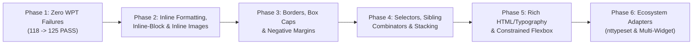

# `nthtml` Feature & Conformance Roadmap

## 1. Where We Are Today

Over the first 19 commits, `nthtml` has grown from an initial bounded HTML-to-image prototype into a dual-mode (**Typeset** pixel raster + **TTY** terminal-cell layout) pure-Go document engine running identically on native Go (Bubble Tea v2 / `ntpicture`) and `js/wasm`.

### Delivered Capabilities
* **Core Engine & Resource Safety ([document/document.go](document/document.go))**: Token-stack HTML parser (`Parse`), bounded XHTML conformance ingestion ([internal/conformance/xhtml.go](internal/conformance/xhtml.go)), context cancellation, and strict `Limits` (`ErrLimit` enforcement on bytes, nodes, depth, rules, pixels, height, and per-stage work budgets).
* **Selectors, Cascade, & Units ([document/selectors.go](document/selectors.go), [document/css.go](document/css.go), [document/length.go](document/length.go), [document/colors.go](document/colors.go))**: Tag, `.class`, `#id`, `*`, compound selectors, descendant and child (`>`) combinators, specificity + `!important`, `px`/`%`/`em`/`rem`/`in`/`cm`/`mm`/`q`/`pt`/`pc`, and full CSS Color 4 syntax (`rgb`/`hsl` legacy & modern space/slash, 3/4/6/8-digit hex, named colors, `currentColor`).
* **Box Model, Positioning, & Floats ([document/layout.go](document/layout.go), [document/margins.go](document/margins.go), [document/position.go](document/position.go), [document/floats.go](document/floats.go))**: `margin`/`padding`/`border`, `box-sizing`, `width`/`height` + `min-*`/`max-*` with visible overflow, horizontal `auto` centering, nonnegative vertical margin collapse, constrained `position: relative|absolute`, and `float: left|right` + `clear` with inline text exclusion.
* **Typography & Whitespace ([document/fonts.go](document/fonts.go), [document/font_values.go](document/font_values.go), [document/tty_whitespace.go](document/tty_whitespace.go))**: Embedded `ntfonts` + custom `FaceSource`, `font` shorthand, `line-height` (normal, lengths, multipliers, zero/short leading), signed `word-spacing`, and `white-space` (`normal`, `nowrap`, `pre`, `pre-wrap`, `pre-line`, `break-spaces`) + `overflow-wrap`.
* **Tables & Embedded Media ([document/table.go](document/table.go), [document/table_grid.go](document/table_grid.go), [document/table_borders.go](document/table_borders.go), [document/image.go](document/image.go), [document/diagram.go](document/diagram.go))**: Content-aware column sizing, `colspan`/`rowspan`, `border-collapse: collapse|separate`, `border-spacing`, vertical alignment, TTY Unicode tables, allowlisted images (`ImageSources`), and pure-Go inline `<svg>` + Mermaid rendering via `ntsvg`.
* **Viewer & Navigation ([model.go](model.go), [document/navigation.go](document/navigation.go), [document/links.go](document/links.go))**: Hyperlinks (pixel hit regions + OSC 8), local `#fragment` scrolling, `/`-search, text selection, OSC 52 copy, and `Result.PageBreak` ([document/pages.go](document/pages.go)).

### Current WPT Conformance Baseline ([internal/conformance/README.md](internal/conformance/README.md))
Across the **200 pinned WPT visual reference tests**:
* **177 PASS** (100% of the 177 runnable cases; 88.5% of total selected corpus)
* **0 FAIL** (Phases 1, 2, 3, 4, & 5 complete)
* **23 UNSUPPORTED** (explicitly gated on missing CSS/HTML prerequisites in test or reference fixtures)

---

## 2. Roadmap Overview

| Phase | Focus Area | Target WPT Impact | Key Files Affected |
| :--- | :--- | :--- | :--- |
| **Phase 1** | Fix all 7 current WPT failures (`#000000` initial fg, auto-width table shrink-to-fit, adjacent `nowrap` span wrapping) | **+7 PASS** (125/125 runnable, 0 FAIL) | [document/table.go](document/table.go), [document/layout.go](document/layout.go), [document/css.go](document/css.go) |
| **Phase 2** | Inline ``, `display: inline-block`, inline box backgrounds/margins, CSS-wide keywords (`inherit`/`initial`/`unset`) | **+25 to 30 PASS** | [document/layout.go](document/layout.go), [document/image.go](document/image.go), [document/table_intrinsic.go](document/table_intrinsic.go), [document/css.go](document/css.go) |
| **Phase 3** | Per-side borders, 256px border caps, negative margins | **+15 to 20 PASS** | [document/border_values.go](document/border_values.go), [document/margins.go](document/margins.go), [document/css.go](document/css.go) |
| **Phase 4** | Attribute/sibling/pseudo selectors, `::before`/`::after`, `z-index` | **+12 to 15 PASS** | [document/selectors.go](document/selectors.go), [document/position.go](document/position.go) |
| **Phase 5** | HTML element coverage (`h3`-`h6`, `hr`, `blockquote`, `dl`), list styles, 1D flex | New corpus expansion | [document/css.go](document/css.go), [document/layout.go](document/layout.go), [document/tty.go](document/tty.go) |
| **Phase 6** | `nttypeset` integration, dynamic widget reflow, multi-widget Kitty | Host / TUI integration | [model.go](model.go), [document/document.go](document/document.go) |

---

## 3. Detailed Phases

### Phase 1: Resolve Current WPT Failures (100% Runnable Pass Rate)

Fixing these three targeted discrepancies brings the runnable WPT baseline from **118/125 (94.4%)** to **125/125 (100%)** with `task conformance -- -strict` passing cleanly.

1. **CSS Initial `color` (`#000000`) & Demo Stylesheets (`border-001`, `t422-rgba-a1.0-a`, `specificity-007`, `font-051`)**
   * **Change**: Update `Document.Render` in [document/layout.go](document/layout.go) to initialize root `fg` to `color.RGBA{0, 0, 0, 255}` (CSS initial `black`) instead of `color.RGBA{30, 36, 46, 255}`.
   * **Demo Preservation**: Explicitly set `color: #1e242e` on `body` in demo HTML documents that rely on the slate palette, and regenerate previews/goldens as needed.

2. **Shrink-to-fit Auto Table Widths (`margin-001`, `padding-001`)**
   * **Root cause**: In `layout.table` and `tableWidths` ([document/table.go](document/table.go)), a `<table>` with `width: auto` always stretches to fill the available container width `w` by distributing `room > demand` across columns. Per CSS 2.1 §17.5.2.2, an auto-width table sizes to `min(max(minimumTableWidth, ExplicitMinWidth), min(preferredTableWidth, availableWidth))` unless an explicit width (`px` or `%`) requests wider expansion.
   * **Fix**: Compute the table's shrink-to-fit outer width before `layout.table` when `s.width` is `auto` (using `preferredCell` / column preferred widths + border/spacing, clamped by `min-width`, `max-width`, and available width), while preserving horizontal `auto` margins and explicit `width: 100%` expansion on demo tables.

3. **Line-Break Opportunities Between Adjacent `nowrap` Spans (`white-space-007`)**
   * **Root cause**: In `layout.flow` ([document/layout.go](document/layout.go)), wrapping checks `st.whiteSpace != "nowrap"` on the current text node's style. When two `` elements sit inside a normal-wrapping parent block, the boundary or collapsible space between those inline spans does not evaluate wrapping against the parent/enclosing inline context.
   * **Fix**: Track whether a break opportunity (inter-span whitespace or boundary outside a shared `nowrap` ancestor) occurred before the current run so adjacent `nowrap` spans can wrap between each other while keeping their internal text unbroken.

---

### Phase 2: Inline Formatting Context, `inline-block`, & Inline Images

Supporting inline replaced elements (``), `display: inline-block`, inline box decorations, and CSS-wide inheritance keywords is the **single highest-leverage feature** for WPT conformance, unlocking **25–30 `UNSUPPORTED` cases** across `white-space-*`, `line-height-*`, `word-spacing-*`, and `normal-flow/*` reference files.

1. **Inline Replaced Elements (`` and inline `<svg>`)**
   * Default `` to `display: inline` in `Document.styled` ([document/css.go](document/css.go)) while preserving `display: block` when explicitly styled.
   * In `layout.flow` ([document/layout.go](document/layout.go)), measure and place inline `` boxes on the current line box, advancing `px` by image width, growing `lineHeight` to accommodate image height, and aligning the image bottom to the text baseline (or `vertical-align: top|middle|bottom|baseline`).
   * Update `preferredCell` ([document/table_intrinsic.go](document/table_intrinsic.go)) and `inlineLine` ([document/margins.go](document/margins.go)) so adjacent inline `` elements contribute to line/word intrinsic widths and non-empty line detection.

2. **`display: inline-block`**
   * Accept `display: inline-block` in `Document.styled` ([document/css.go](document/css.go)).
   * In `layout.flow` ([document/layout.go](document/layout.go)), lay out `inline-block` children as mini formatting contexts (using shrink-to-fit width via `preferredCell` when `width: auto`), wrap them across lines like words, and translate their painted ops into position on the line box.

3. **Inline Box Decorations & Horizontal Spacing**
   * Support `background-color`, `padding-left`/`right`/`top`/`bottom`, `border`, and `margin-left`/`right` on inline elements (``, `<code>`, `<a>`) inside `layout.flow` ([document/layout.go](document/layout.go)).
   * Directly unblocks `word-spacing-007`, `008`, `019`, `020`, `031`, `032` (whose references use `` to simulate word spacing) and improves inline `<code>` rendering.

4. **CSS-Wide Keywords (`inherit`, `initial`, `unset`)**
   * Handle `inherit`, `initial`, and `unset` in `Document.styled` ([document/css.go](document/css.go)) and shorthand expansion so explicit inheritance works on non-inherited properties and resets work on inherited properties (`font-*`, `color`, `white-space`, `line-height`), required by several `white-space-*` WPT fixtures.

---

### Phase 3: Borders, Box Model Caps, & Negative Margins

Unlocks ~15–20 currently `UNSUPPORTED` WPT cases in `boxes and positioning` and `typography`.

1. **Per-Side Borders (`border-top`, `border-right`, `border-bottom`, `border-left`)**
   * Expand `style` ([document/css.go](document/css.go)) from scalar `bw int`, `border color.RGBA`, `borderSet bool` to 4-element arrays `[4]int`, `[4]color.RGBA`, `[4]string` (top, right, bottom, left).
   * Support `border-top/right/bottom/left`, `border-top/right/bottom/left-width/style/color`, and 1-to-4 value `border-width` / `border-style` / `border-color` shorthands in `declarations` ([document/css.go](document/css.go)) and [document/border_values.go](document/border_values.go).
   * Update `layout.blockStyled` ([document/layout.go](document/layout.go)), [document/margins.go](document/margins.go), and [document/table_borders.go](document/table_borders.go) to use per-side border widths and colors.
   * Add `dashed`, `dotted`, and `hidden` border styles.

2. **Raise Border Width Resource Ceiling**
   * Currently `Document.styled` ([document/css.go](document/css.go)) caps `border-width` at `32px`, while padding and margins allow up to `256px`.
   * Raising the border-width cap to `256px` (still bounded by box/canvas dimensions) unblocks `border-005`, `border-006`, `border-008` (`1in` = `96px` borders) and the 12 `normal-flow/{width,height,min-*,max-*}-006/007` tests.

3. **Bounded Negative Margins**
   * Allow signed lengths on `margin` properties (capped at `[-256px, +256px]`) in [document/css.go](document/css.go).
   * Extend `blockMargins` ([document/margins.go](document/margins.go)) to track `maxPositive` and `minNegative` adjoining margins (`resolved = maxPositive + minNegative`), unblocking negative-margin positioning and `line-height` reference fixtures.

---

### Phase 4: Selector Engine, Pseudo-Elements, & Stacking

Unlocks ~12–15 `UNSUPPORTED` WPT cases in `selectors and cascade` and `text`.

1. **Attribute Selectors & Combinators ([document/selectors.go](document/selectors.go))**
   * Add attribute matching to `selectorPart`: `[attr]`, `[attr=val]`, `[attr~=val]`, `[attr|=val]`, `[attr^=val]`, `[attr$=val]`, `[attr*=val]` (with optional `i` case-insensitivity flag and quoted/unquoted values), scored with class-level specificity (`1 << 10`). Unblocks `id-selector-006`, `descendent-selector-008`, `descendent-selector-009`, and specificity cases.
   * Add adjacent sibling (`+`) and general sibling (`~`) combinators by indexing child positions or parent links on `node` ([document/document.go](document/document.go)).

2. **Structural Pseudo-Classes**
   * Support `:root`, `:first-child`, `:last-child`, `:only-child`, `:empty`, `:nth-child(an+b)`, and simple `:not(...)` in [document/selectors.go](document/selectors.go).

3. **Bounded `::before` / `::after` & Integer `z-index`**
   * Support static `content: "..."` on `::before` and `::after` pseudo-elements (capped to e.g. 256 bytes per pseudo-element, no recursive generation).
   * Parse integer `z-index` on positioned boxes and sort `positionFrame.children` ([document/position.go](document/position.go)) by `(zIndex, sourceOrder)`, unblocking negative `z-index` cases such as `white-space-008`.

---

### Phase 5: Rich HTML/Typography, Lists, & Constrained Flexbox

Expands real-world document fidelity for Markdown, technical documentation, reports, and dashboards across both **Typeset** and **TTY** modes.

1. **HTML Element & Typography Completeness**
   * **UA Element Defaults ([document/css.go](document/css.go))**: Add built-in sizing/margins for `h3` (20px), `h4` (16px bold), `h5` (14px bold), `h6` (12px bold), `blockquote` (left margin/border indent), `hr` (1px rule in Typeset, `───` horizontal rule in TTY), `small` (85% font size), `sub`/`sup` (baseline shift + smaller font), `mark` (highlight background), and `<dl>`/`<dt>`/`<dd>`.
   * **Text Styling**: Add `letter-spacing`, `text-indent`, `text-transform` (`uppercase`, `lowercase`, `capitalize`), `font-variant: small-caps` (synthesizing scaled uppercase glyphs when font lacks native small-caps, plus synthetic bold/oblique Ahem support in conformance if desired), and `text-align: justify`.

2. **List & Table Enhancements**
   * Support `<ol reversed>`, `type="1|a|A|i|I"`, and `list-style-type` (`disc`, `circle`, `square`, `decimal`, `lower-alpha`, `upper-alpha`, `lower-roman`, `upper-roman`, `none`) in [document/blocks.go](document/blocks.go) and [document/tty.go](document/tty.go).
   * Support `<colgroup>` and `<col>` width/background hints in [document/table_grid.go](document/table_grid.go).
   * Support `caption-side: top | bottom`.

3. **Constrained 1D Flexbox & Overflow Clipping**
   * Implement a bounded, single-pass `display: flex` subset (`flex-direction: row | column`, `gap`, `justify-content`, `align-items`, `flex-wrap: nowrap | wrap`, `flex: <grow> <shrink> <basis>`) with a strict flex-item work budget—ideal for metric cards, headers, and multi-column report layouts without needing floats or tables.
   * Implement `overflow: hidden` rectangle clipping in `layout.blockStyled` ([document/layout.go](document/layout.go)) and `text-overflow: ellipsis` for single-line clipped blocks.

---

### Phase 6: Nimble Terminal Ecosystem & Host Integrations

1. **Direct `nttypeset` Adapter**
   * Build an optional `nttypeset` layout/shaping bridge consuming `nthtml`'s parsed style tree or `Result.Boxes` ([document/layout.go](document/layout.go)) for Unicode UAX #14 line breaking, hyphenation, justification, and per-glyph font fallback.
2. **Responsive Typeset Reflow & Multi-Widget Kitty Support in [`nthtml.Model`](model.go)**
   * Add an opt-in option on `nthtml.Model` to re-render the underlying `Document` when terminal pixel/column width changes significantly, matching the browser demo's container-resize behavior.
   * Expose Kitty placement IDs / sub-viewport bounds so parent Bubble Tea applications can compose multiple `nthtml.Model` instances side-by-side.
3. **TinyGo / Embedded Target Verification**
   * Benchmark memory footprint and binary size of the standalone `document` package under TinyGo / constrained budgets and provide an opt-in minimal font bundle.
